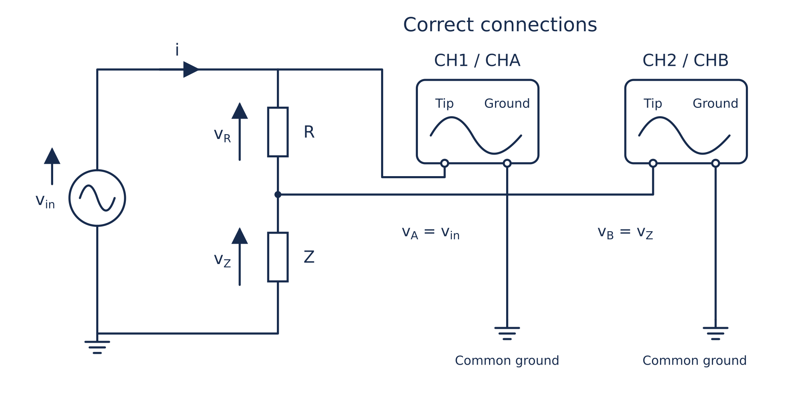
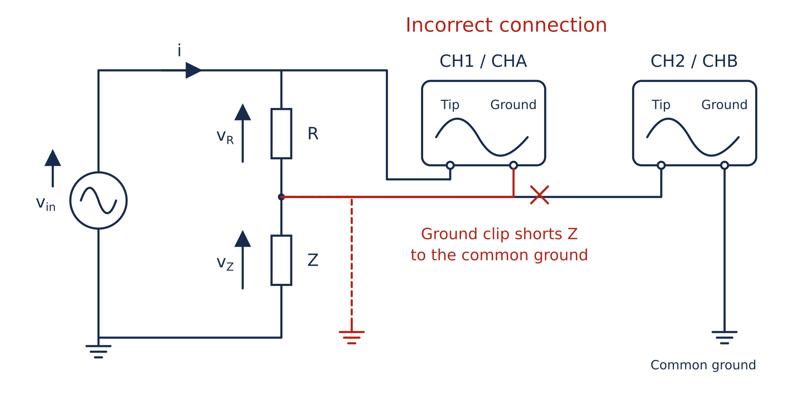
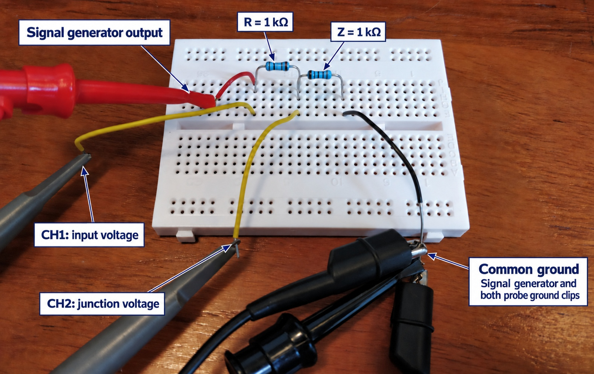
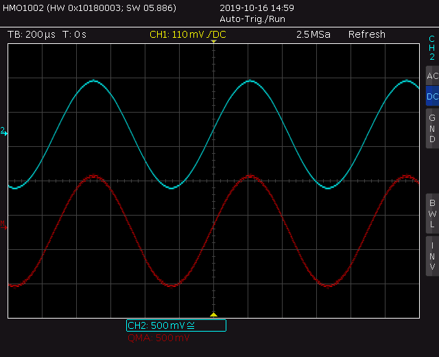
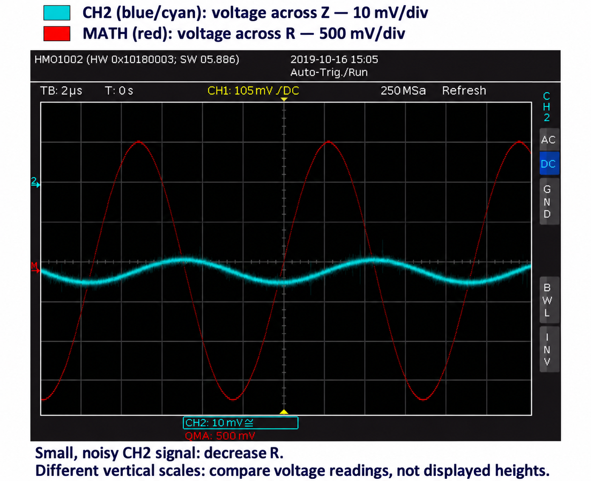
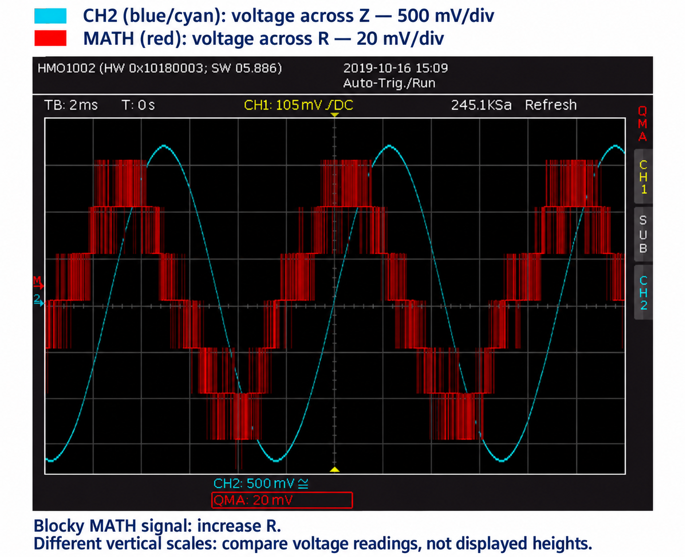
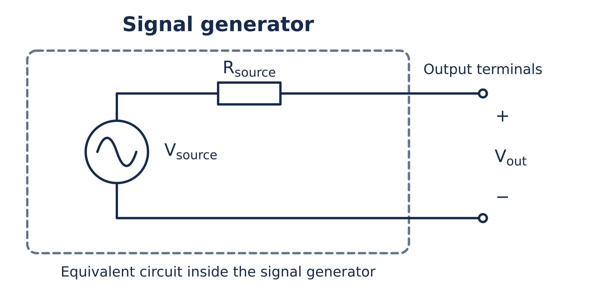
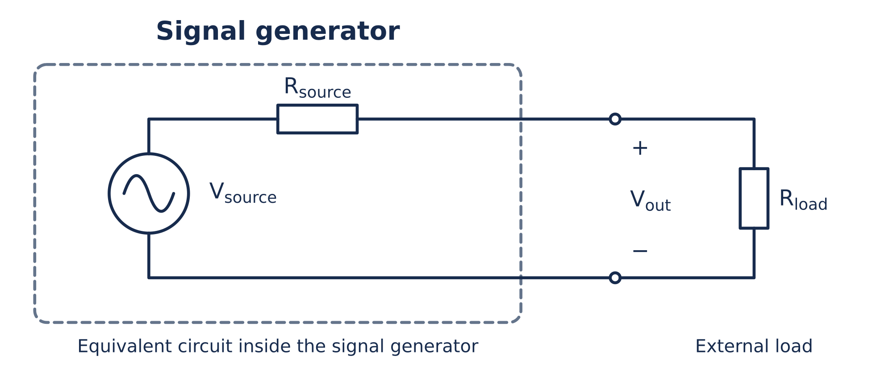

# Analysis and Design of Circuits Lab
# Part 1: Autumn Term weeks 4–6

This laboratory explores passive components: resistors, capacitors and inductors, and how they can be combined to make frequency-dependent circuits.

In Section 1, you will learn how to measure impedance using a known resistor and an oscilloscope. [Section 2](Section2.md) explores reactive components and first-order filters. [Section 3](Section3.md) investigates resonance and second-order filters.

## Section 1: Measuring Impedance

### What you will do

1. Build a two-resistor divider and display the required voltages.
2. Measure the voltage ratio and calculate the resistance of the second resistor.
3. Compare cursor and automatic measurements.
4. Interpret two examples of unreliable measurements and decide how to improve them.

Complete these activities using the instructions below. Keep the measurements, calculations and short explanations in your laboratory record. The final source-resistance experiment is a challenge task.

### The measurement principle

For a resistor, Ohm’s law relates the voltage across it to the current through it. Impedance extends this idea to components such as capacitors and inductors when we analyse sinusoidal signals.

To determine a component’s impedance, we need to know the voltage across it and the current through it. However, an oscilloscope probe measures voltage rather than current.

**We can determine an unknown impedance by measuring the ratio of two voltages and multiplying that ratio by a known impedance.** Connect a known impedance and the unknown impedance in series, so that the same current flows through both. Their voltage ratio is then equal to their impedance ratio:

$$
Z_\mathrm{unknown}=Z_\mathrm{known}\frac{V_\mathrm{unknown}}{V_\mathrm{known}}.
$$

Here, the voltages are phasors, so the ratio includes both amplitude and phase. In this experiment, we use a known **resistor** as the reference impedance. This makes the measurement particularly straightforward: multiply the ratio of the measured voltage amplitudes by the known resistance to obtain the unknown impedance magnitude.

We will first explain this principle, then show how to connect the oscilloscope correctly to measure the two voltages.

Place the known resistor $R$ in series with the unknown impedance $Z$:

  

The lowercase voltage labels in this diagram represent the sinusoidal signals that we observe on the oscilloscope. We use uppercase symbols when expressing those same signals as phasors in the equations below.

The same current flows through both components. If the instantaneous voltage across the known resistor is $v_R$, then:

$$
i=\frac{v_R}{R}.
$$

In the initial experiment, both components are resistors, so their voltages and current are in phase. The unknown resistance can therefore be calculated from the ratio of their voltage amplitudes.

For capacitors and inductors, voltage and current may have different phases. We describe these sinusoidal quantities using complex voltages and currents, or **phasors**. Uppercase $V$ and $I$ denote phasors; lowercase $v$ and $i$ denote instantaneous signals.

Using phasors:

$$
I=\frac{V_R}{R},
\qquad
Z=\frac{V_Z}{I}=R\frac{V_Z}{V_R}.
$$

If we measure only the amplitudes of the two voltages, we obtain the **magnitude of the impedance**:

$$
|Z|=R\frac{|V_Z|}{|V_R|}.
$$

The phase difference between these voltages provides the phase of the impedance:

$$
\arg(Z)=\arg(V_Z)-\arg(V_R).
$$

This works because the voltage across a resistor is in phase with the current through it. We will return to reactive components in Section 2.

### Connecting the oscilloscope correctly

The oscilloscope channels measure voltages relative to a common ground. Their probe ground clips are connected together inside the instrument and, in this setup, share the signal generator’s ground.

**Both probe ground clips must connect to the circuit’s common ground.** They cannot be connected to different circuit nodes without joining those nodes together electrically.

Connect the probes as follows:

- Connect the **CH1 probe tip** to the top of the divider to measure $v_A$, which is also $v_\mathrm{in}$.
- Connect the **CH2 probe tip** to the junction between $R$ and $Z$ to measure $v_Z$.
- Connect **both probe ground clips** to the bottom of $Z$, at the circuit’s common ground.

The channels are also referred to as CHA and CHB in the instructions and figures: CHA corresponds to CH1, and CHB to CH2.

  

Each channel now measures a voltage relative to the same reference node. From Kirchhoff’s voltage law:

$$
v_A=v_R+v_Z.
$$

Therefore, the voltage across the known resistor is:

$$
v_R=v_A-v_Z.
$$

The oscilloscope’s **math channel** performs this subtraction, sample by sample, when set to **CH1 − CH2**.

Subtract the waveforms using the math channel before measuring the amplitude of $v_R$. For reactive components, subtracting the two amplitude readings alone generally gives the wrong answer because the waveforms may have different phases.

### Why a probe must not be connected directly across R

It may seem natural to measure $v_R$ by connecting a probe tip to the top of $R$ and its ground clip to the junction between $R$ and $Z$.

However, the ground clip is already connected internally to the signal generator’s ground. Connecting it to the junction creates a conducting path from the junction to the bottom of $Z$. This **short-circuits $Z$** and changes the circuit being measured.

  

The probe ground clip cannot be treated as an independent negative measurement terminal. Keep both ground clips at the common ground and use the math channel to calculate the voltage across $R$.

### Before taking measurements

For each measurement:

- Check that the circuit and both probe ground clips share the same common ground.
- Set both probe switches to **×10** and configure both oscilloscope channels for **×10 probes**.
- Use **DC coupling** so that the channels measure the complete signals without introducing additional low-frequency attenuation and phase shifts.
- Adjust the vertical scales so that both measured waveforms occupy a useful portion of the display without clipping.

Matching the physical probe settings to the oscilloscope settings is essential for correct voltage readings.

### Activity 1: build and check the measurement circuit

Begin with two equal resistors so that you can check the measurement method before using a capacitor or inductor.

1. Build the potential-divider circuit with $R=1\,\mathrm{k}\Omega$ and a second $1\,\mathrm{k}\Omega$ resistor in the position labelled $Z$.
2. Connect CH1 to measure $v_A=v_\mathrm{in}$ and CH2 to measure $v_Z$, following the grounding instructions above.
3. Set the signal generator to a **100 Hz sine wave**, with **1 V peak amplitude** (2 V peak-to-peak) and **0 V DC offset**. Check the actual input voltage on CH1; the generator’s displayed amplitude may depend on its load setting.
4. Set the oscilloscope timebase to **5 ms/div**.
5. Select **CH1 as the trigger source**, use **Auto trigger mode**, and place the trigger level near the centre of the CH1 waveform.

We use a sine wave because sinusoidal measurements will also allow us to characterise capacitors and inductors.

  

Press `MATH` and select `CH1`, `SUB` and `CH2` to display:

$$
v_R=\mathrm{CH1}-\mathrm{CH2}.
$$

You can hide CH1 by pressing its channel button twice. It will still be used to calculate the math trace and provide the trigger.

Since the two resistors are equal, the input voltage should divide equally between them. The $v_R$ and $v_Z$ waveforms should therefore have approximately equal amplitudes and be in phase.

  

In this screenshot, the blue/cyan trace is **CH2**, showing $v_Z$, and the red trace is **MATH**, showing $v_R$. Both use 500 mV/div and have similar amplitudes. The traces have been shifted vertically to make them easier to compare; their different screen positions do not imply different DC voltages. Their peaks occur at approximately the same times, showing that they are in phase.

The screenshots illustrate the measurement behaviour; their timebase and other settings need not match the starting settings above. Identify traces by their channel labels as well as their colours.

- [ ] Display $v_R$ using the math channel and compare it with $v_Z$.
- [ ] Confirm that $v_R\approx v_Z$ when the two resistors are equal.
- [ ] Use the measured voltage ratio and the known resistance to calculate the resistance of the component in the position labelled $Z$.

Small differences are expected because real resistors have tolerances and voltage measurements have finite accuracy.

### Activity 2: measure the voltage ratio and calculate resistance

When the two components are different, measure the amplitudes of both $v_Z$ and $v_R$ and calculate:

$$
|Z|=R\frac{|V_Z|}{|V_R|}.
$$

You can use peak, peak-to-peak or RMS values in this ratio, provided you use the **same measurement convention for both sinusoidal signals**.

For a sine wave with zero DC offset:

$$
V_\mathrm{pp}=2V_\mathrm{peak},
\qquad
V_\mathrm{RMS}=\frac{V_\mathrm{peak}}{\sqrt{2}}.
$$

The conversion factor cancels in the voltage ratio. For example:

$$
|Z|=R\frac{V_{Z,\mathrm{pp}}}{V_{R,\mathrm{pp}}}
   =R\frac{V_{Z,\mathrm{RMS}}}{V_{R,\mathrm{RMS}}}.
$$

Do not divide a peak-to-peak reading for one waveform by an RMS reading for the other.

1. Measure the actual value of the test resistor $R$ with the circuit unpowered and the resistor isolated from other current paths. Reconnect it afterwards.
2. Restore the 100 Hz sine wave and check the connections and math-channel setting.
3. Use voltage cursors to measure the peak-to-peak voltage on CH2 and on MATH.
4. Enter the readings in the table and calculate $|Z|=R V_{Z,\mathrm{pp}}/V_{R,\mathrm{pp}}$.
5. Compare your calculated resistance with the nominal 1 kΩ value. Explain any small difference using resistor tolerance and measurement uncertainty.

| Frequency (Hz) | Measured test resistance $R$ (Ω) | CH2: $V_{Z,\mathrm{pp}}$ (V) | MATH: $V_{R,\mathrm{pp}}$ (V) | Calculated resistance $|Z|$ (Ω) |
| --- | --- | --- | --- | --- |
| 100 | | | | |

- [ ] Record both voltage readings and show the resistance calculation.

#### Using cursors

Peak-to-peak measurements are convenient with cursors because the waveform’s maximum and minimum are easier to identify than its exact centre.

Place one voltage cursor at the positive peak and the other at the negative peak. Their difference gives the peak-to-peak voltage.

Measure $v_Z$ on CH2 and $v_R$ on the math channel.

### Activity 3: compare measurement methods

Using cursors repeatedly can be laborious, so the oscilloscope also provides automatic measurement functions.

Press `AUTO MEASURE` to enable measurements. You can display up to six measurements and select the source and measurement type for each.

Add the following measurements for both **CH2** ($v_Z$) and **MATH** ($v_R$):

- Amplitude
- Peak-peak
- RMS

Check what each function measures. In oscilloscope menus, **“Amplitude” does not necessarily mean the mathematical peak amplitude**. It commonly measures the difference between estimated upper and lower waveform levels, so it may be close to the peak-to-peak reading.

The peak-to-peak function uses the waveform’s extreme values and can be affected by noise spikes. The amplitude function estimates the waveform levels and may be less sensitive to occasional spikes. Compare the automatic readings with your cursor measurements rather than assuming that every function gives the same quantity.

RMS measurements may include a DC component, depending on the selected function. For the zero-offset sine waves used here, compare the readings with the sine-wave relationship above.

Keep the same circuit and generator settings. Record the measurements below; enter all voltage readings in volts. For the RMS prediction, divide the cursor peak-to-peak value by $2\sqrt{2}$.

| Measurement method | CH2: voltage across $Z$ (V) | MATH: voltage across $R$ (V) |
| --- | --- | --- |
| Cursor peak-to-peak | | |
| Automatic “Amplitude” | | |
| Automatic “Peak-peak” | | |
| Predicted RMS from cursor reading | | |
| Automatic RMS | | |
| Multimeter AC reading, where within specification | | |

Connect the multimeter directly across each resistor in turn using its voltage inputs. Its reading is an independent check; the oscilloscope ground-clip restrictions still apply to the oscilloscope probes.

- [ ] Compare the automatic amplitude and peak-to-peak readings with your cursor measurements.
- [ ] Check whether the RMS readings are consistent with those expected for a sine wave.
- [ ] Compare with an AC voltage measurement from the multimeter, ensuring that the signal frequency is within its specified measurement range.

### Activity 4: interpret unreliable measurements and choose R

The impedance magnitude is calculated from:

$$
|Z|=R\frac{|V_Z|}{|V_R|}.
$$

For this activity, **study the two screenshots below; you do not need to reproduce the faults**. For each, identify the unreliable voltage measurement, explain the problem and decide whether to increase or decrease $R$.

The accuracy of this result depends on the accuracy of the known resistance and both voltage measurements. Component tolerances, electrical noise, oscilloscope resolution and probe loading can all introduce errors.

The choice of test resistor $R$ is particularly important. Aim to make $R$ similar in magnitude to the unknown impedance $|Z|$, so that both voltage signals can be measured clearly. They do not need to be exactly equal, but a very large difference makes one of the measurements difficult.

For a capacitor or inductor, $|Z|$ changes with frequency. A test resistor that works well at one frequency may therefore be unsuitable at another.

#### When R is too large

If $R$ is much larger than $|Z|$, most of the input voltage appears across $R$, leaving only a small voltage across $Z$.

The CH2 signal may then become comparable with electrical noise or the smallest voltage changes the oscilloscope can resolve. Even a small absolute error becomes a large percentage error in this small voltage.

**Decrease R** to increase the proportion of the input voltage appearing across $Z$ and make it easier to measure.

*Blue/cyan is CH2 ($v_Z$), at 10 mV/div. Red is MATH ($v_R$), at 500 mV/div. The small, noisy CH2 waveform is the unreliable measurement. Decrease R to increase the voltage across Z. The two traces have different scales: compare voltage readings, not just their heights on screen.*

  

#### When R is too small

If $R$ is much smaller than $|Z|$, most of the input voltage appears across $Z$. CH1 and CH2 then display nearly identical waveforms.

The math channel calculates:

$$
v_R=v_\mathrm{in}-v_Z.
$$

In this case, it is subtracting two relatively large, nearly equal signals to obtain a small difference. Noise, limited resolution and small differences between the channel or probe responses can become significant compared with that difference.

The resulting math trace may look noisy or blocky, and its amplitude may be unreliable. Enlarging the math trace on the display does not recover detail that was missing from the original channel measurements.

**Increase R** to increase the voltage across it and produce a better-resolved math-channel signal.

*Blue/cyan is CH2 ($v_Z$), at 500 mV/div. Red is MATH ($v_R$), at 20 mV/div. The red math trace is blocky and unstable even though it looks large on screen: it has been displayed at a much more sensitive scale. Increase R to make the voltage across it larger relative to the acquisition errors. Enlarging the math trace alone does not improve the underlying measurement.*

  

#### Choosing a practical resistance

Start with $R=1\,\mathrm{k}\Omega$ and examine both CH2 and the math trace.

- If the voltage across $Z$ is too small or noisy, **decrease R**.
- If the math-channel voltage across $R$ is too small or poorly resolved, **increase R**.
- Adjust the vertical scales of both input channels so that the waveforms occupy a useful portion of the display without clipping.
- If you have an approximate theoretical value of $|Z|$, choose an available resistor of a similar magnitude.
- Whenever you change $R$, record its new value and use it in the impedance calculation.

As a practical starting point, if the voltage across $Z$ is below about **5 mV RMS** and cannot be resolved clearly, try a smaller resistor. If the math trace is blocky, unstable or dominated by noise, check the scaling of CH1 and CH2 and try a larger resistor.

**A trace filling the screen is not proof of a good measurement.** Changing the math display scale can magnify a poorly resolved signal without improving the data from which it was calculated. Check the waveform's smoothness and stability as well as its amplitude, and read each trace's own volts-per-division setting.

These are guides rather than guarantees of accuracy. Always inspect the waveforms. Change the resistance in sensible steps; a factor of ten is often useful. For this experiment, do not reduce the test resistance below **10 Ω**.

#### When both R and Z are small

Choosing $R$ similar to $|Z|$ helps balance the two voltage measurements, but it does not solve every measurement problem.

If both are small, the circuit presents a low impedance to the signal generator. Maintaining the same input voltage would require a larger current:

$$
I=\frac{V_\mathrm{in}}{R+Z},
$$

where the quantities in this expression are phasors.

A real signal generator has an internal source resistance and a limited output-current capability. Under heavy loading, its terminal voltage can fall. If its output stage approaches its current limit, the waveform may also become distorted. Small measured voltages can additionally make noise more prominent.

Consequently, reducing $R$ may increase the proportion of voltage across $Z$ while also increasing the load on the generator.

Check the actual input waveform on CH1 whenever you use small impedances:

- Confirm that it remains a clean sine wave.
- Measure the actual input rather than assuming it equals the generator’s displayed setting.
- If the waveform becomes distorted, reduce the generator amplitude or increase $R$, then check that both measured voltages are still large enough to resolve.
- If you cannot obtain clean, measurable signals, ask a demonstrator for help.

A reduction in input amplitude alone does not invalidate the voltage-ratio method, provided both voltages are measured accurately and the circuit remains linear. Distortion is more problematic: a distorted waveform contains several frequencies, so its amplitude ratio cannot generally be interpreted as the impedance magnitude at one frequency.

#### Other sources of error

**Resistor tolerance:** the actual test resistance may differ from its labelled value. Measure it with a multimeter while the circuit is unpowered and the resistor is isolated from other current paths. Use the measured value in your calculation.

**Probe and channel mismatch:** both probes must have the same attenuation setting, with matching settings on the oscilloscope. Check probe compensation. Differences in gain or phase between the channels can introduce errors when their signals are subtracted.

**Probe loading:** a probe has a finite input resistance and capacitance, so connecting it changes the circuit slightly. This becomes more important when measuring large impedances or working at higher frequencies. The ×10 setting reduces this loading compared with ×1 operation.

**Noise and connections:** loose contacts, long leads and poor grounding can produce unstable or noisy readings. Keep connections short and secure, and connect both probe ground clips to the circuit’s common ground.

**Measurement consistency:** use the same amplitude convention for both voltages. Check automatic measurements against the displayed waveforms, especially when a signal is small or noisy.

Record your interpretation of the screenshots:

| Screenshot | Unreliable trace | Evidence from the waveform and scale | Increase or decrease $R$? | Why will this help? |
| --- | --- | --- | --- | --- |
| Small, noisy component voltage | | | | |
| Blocky math-channel voltage | | | | |

- [ ] Check that both the voltage across Z and the math-channel voltage across R are clearly resolved in your own circuit.
- [ ] Explain whether R should be increased or decreased if either measurement becomes unreliable.
- [ ] Record any changes to R and any limitations affecting your measurements.

## Challenge: source impedance of the signal generator

A real signal generator does not behave as an ideal voltage source. Its output can be represented by a **Thévenin equivalent circuit**: an ideal voltage source in series with a source resistance $R_\mathrm{source}$.

  

When a load resistance is connected, current flows through both the source resistance and the load. Some of the source voltage is dropped across $R_\mathrm{source}$, so the voltage at the output terminals decreases.

This is the loading effect discussed above. In this challenge, we model the source impedance as a resistance at the chosen test frequency.

  

The two resistances form a potential divider:

$$
V_\mathrm{out} = V_\mathrm{source} \frac{R_\mathrm{load}}{R_\mathrm{load}+R_\mathrm{source}}.
$$

Because this model contains only resistances, the same divider relationship applies to the voltage amplitudes.

You will determine $R_\mathrm{source}$ from two output-voltage measurements.

1. Keep the signal generator’s frequency, amplitude, DC offset and load-display setting unchanged throughout the experiment.
2. Connect a $10\,\mathrm{k}\Omega$ load across the output and measure the output-voltage amplitude.
3. Replace it with a $200\,\Omega$ load and measure the output-voltage amplitude again.
4. Use the same amplitude measurement convention for both readings and check that the output remains sinusoidal.
5. Write the potential-divider equation for each load and solve the two simultaneous equations for the source-voltage amplitude and $R_\mathrm{source}$.

Use the same **100 Hz sine wave**, 0 V offset and initially 1 V peak setting. Measure the actual load resistance if possible and record peak-to-peak output voltages:

| Nominal load resistance (Ω) | Actual load resistance used in calculation (Ω) | Output peak-to-peak voltage (V) |
| --- | --- | --- |
| 10 000 | | |
| 200 | | |

The internal source voltage is the same in both equations because the generator settings remain unchanged and the generator is operating within its linear range. The measured output voltage changes because the load changes.

- [ ] Determine the source resistance of the signal generator using the two loads.
- [ ] Explain which load gives the lower output voltage and why.
- [ ] Explain what happens to the output voltage when the load resistance is much larger than the source resistance.
