# Analysis and Design of Circuits Lab
# Part 1: Passive Components - Autumn Term weeks 4–6

## Section 2: Reactive Components and First-Order Filters

Complete the main investigations first, then attempt the tasks labelled **Challenge**. All circuit designs are included; the challenge tasks apply the same principles to similar circuits.

In [Section 1](Section1.md), you measured an unknown impedance by comparing its voltage with the voltage across a known resistor. You will now use that method to investigate two capacitors and two inductors, explain the different regions of their impedance curves, and estimate one unknown inductance from a few readings.

You will then use these frequency-dependent impedances to build filters, including a filter whose gain approaches different non-zero values at low and high frequency.

You will study capacitors and inductors in lectures this week; if you have not covered them yet, do not worry—the basic equations you need for this experiment are provided below.

### Impedance and reactance

For sinusoidal signals, an ideal inductor and an ideal capacitor have impedances:

$$
Z_L=j\omega L,
\qquad
Z_C=\frac{1}{j\omega C}=-\frac{j}{\omega C},
\qquad
\omega=2\pi f.
$$

Here, $f$ is frequency in hertz and $\omega$ is angular frequency in radians per second. Using complex impedances allows us to apply the circuit-analysis methods from the lectures to sinusoidal steady-state circuits without solving differential equations directly.

We write a general impedance as:

$$
Z=R_s+jX,
$$

where $R_s$ is its resistive part and $X$ is its reactance. Both are measured in ohms. Reactance is a real, signed quantity: positive for an ideal inductor and negative for an ideal capacitor. It is $jX$ that forms the imaginary part of the impedance.

For example, at 1 kHz, an ideal 1 mH inductor has $Z_L\approx j6.3\,\Omega$, while an ideal 1 µF capacitor has $Z_C\approx-j159\,\Omega$.

Their impedance magnitudes are:

$$
|Z_L|=2\pi fL,
\qquad
|Z_C|=\frac{1}{2\pi fC}.
$$

An inductor's impedance magnitude increases with frequency; a capacitor's decreases. On logarithmic axes, the ideal relationships are straight lines with gradients of +1 and −1 respectively. Increasing frequency by a factor of ten multiplies the inductive impedance by ten and divides the capacitive impedance by ten.

For an ideal inductor, voltage leads current by 90°. For an ideal capacitor, voltage lags current by 90°. This is why impedance has both magnitude and phase.

### Why are we measuring impedance?

The ideal equations predict how impedance should change with frequency, but real components may behave differently. Their actual capacitance or inductance may differ from the labelled value because of manufacturing tolerances, and their construction introduces additional resistance, capacitance and inductance. Measuring impedance allows us to test the ideal predictions, identify where they are useful and understand where a more realistic model is needed.

This is particularly clear for an inductor. It is made from a coil of wire, and that wire has resistance. As frequency decreases, the inductive reactance $X_L=2\pi fL$ decreases, while the wire's resistance remains approximately constant. At sufficiently low frequency, the wire's resistance is larger than the inductive reactance, so the component behaves predominantly like a resistor.

The inductance has not disappeared; its contribution to the total impedance has become small compared with the resistance. This produces a **flat region at low frequency** on the impedance-magnitude plot: the impedance is approximately constant, just as it is for a resistor. As frequency increases, the inductive reactance becomes dominant and the curve rises.

### Real components and parasitic resistance

Real components also contain unwanted, or **parasitic**, properties. An inductor's wire has resistance, and its closely spaced turns introduce capacitance. A capacitor has losses that can be represented by an equivalent series resistance (ESR), as well as other parasitic properties.

A useful starting model adds a series resistance to each ideal component:

$$
Z_L=R_s+j\omega L,
\qquad
Z_C=R_s+\frac{1}{j\omega C}.
$$

Here, $R_s$ represents the component's series resistance. It is different from the external test resistor $R$ used in the measurement circuit.

  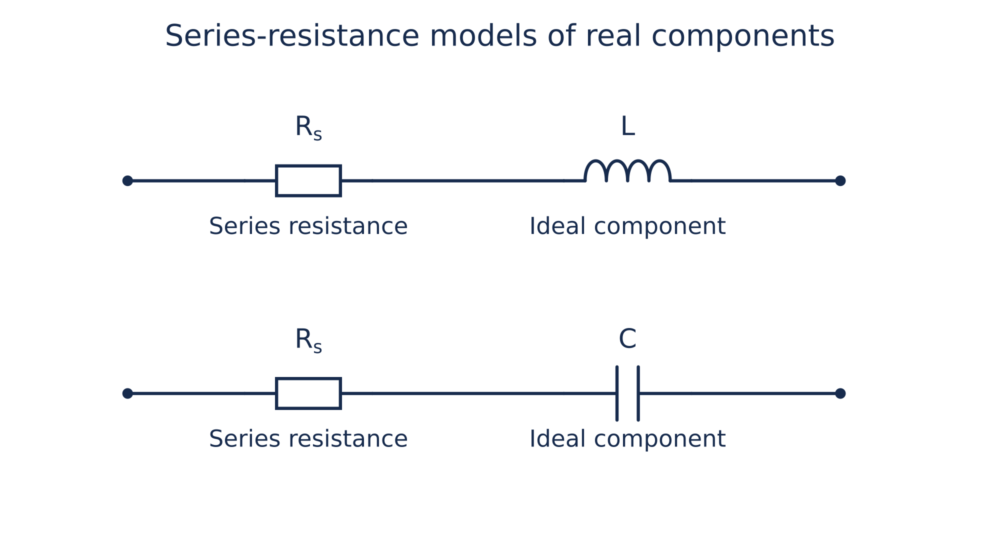

This model helps explain departures from ideal behaviour, but it is an approximation. An inductor's inter-winding capacitance and a capacitor's parasitic inductance can become important near self-resonance. Do not assume that these effects lie outside the measurement range for every component.

### Before the lab

Set up a spreadsheet to calculate an inductor's predicted impedance magnitude and phase using:

$$
|Z_L|=\sqrt{R_s^2+(2\pi fL)^2},
\qquad
\arg(Z_L)=\tan^{-1}\left(\frac{2\pi fL}{R_s}\right).
$$

Start with $L=1\,\mathrm{mH}$ and $R_s=10\,\Omega$. Make both parameters easy to change so that the same spreadsheet can later model your measured components.

1. Create input cells for $L$ and $R_s$ and enter the starting values above.
2. Enter the frequencies in the table below. Calculate $\omega=2\pi f$, impedance magnitude and phase at every frequency using spreadsheet formulas.
3. Convert phase to degrees if your spreadsheet returns radians.
4. Plot the calculated magnitude and phase using the axis settings below. Keep this spreadsheet for the measurements and model fitting.

| Frequency $f$ (Hz) | Angular frequency $\omega$ (rad/s) | Predicted impedance magnitude (Ω) | Predicted phase (°) |
| --- | --- | --- | --- |
| 1 | | | |
| 3.2 | | | |
| 10 | | | |
| 32 | | | |
| 100 | | | |
| 320 | | | |
| 1000 | | | |
| 3200 | | | |
| 10000 | | | |
| 20000 | | | |
| 40000 | | | |

Most of these frequencies are separated by approximately half a decade. Equal steps on a logarithmic frequency axis represent equal ratios, rather than equal differences. The additional 20 kHz and 40 kHz points provide more detail at the upper end of the measurement range.

Plot magnitude against frequency with both axes logarithmic. Plot phase against frequency with a logarithmic frequency axis and a linear phase axis. State whether phase is in radians or degrees and convert consistently.

  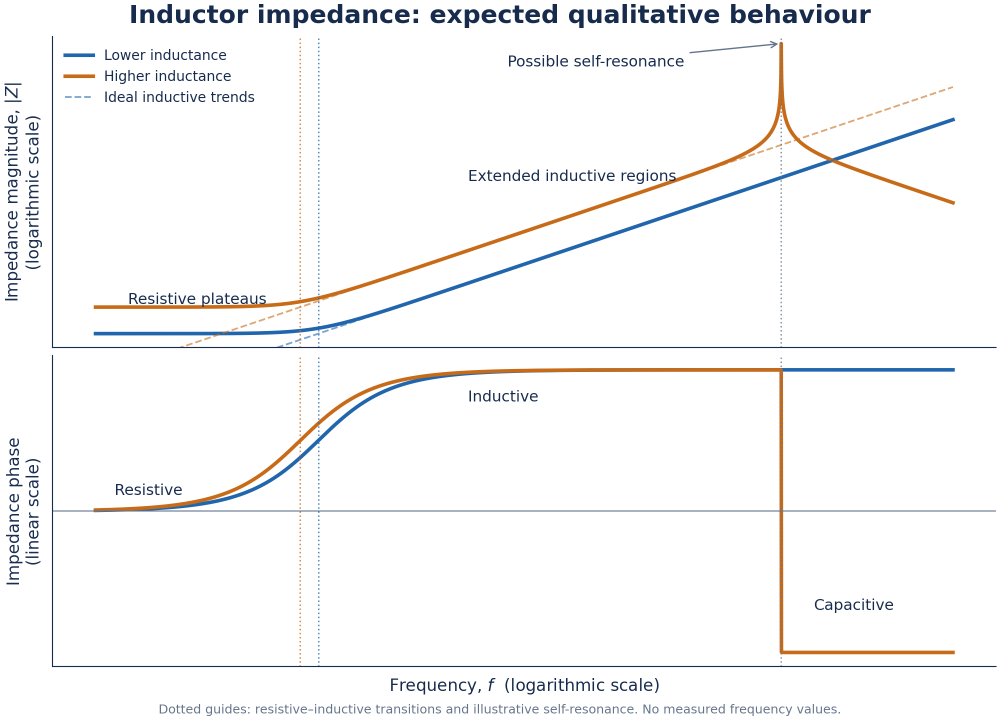

The graph above compares a lower-value and a higher-value inductor. In the ideal inductive region, the higher inductance gives a larger impedance at the same frequency. Each real inductor may also have a different winding resistance, so the heights of their low-frequency plateaus need not be the same.

At sufficiently high frequency, capacitance between the turns of the coil can interact with its inductance and produce **self-resonance**. In a simple model, this gives a peak in impedance magnitude; above resonance, the component can behave predominantly capacitively and its impedance magnitude can fall as frequency increases. Losses keep the peak finite.

The illustrative higher-value inductor shows this possible behaviour. Its position depends on both inductance and parasitic capacitance: a larger inductance alone does not determine the self-resonant frequency. The illustration shows the trend, not a guaranteed result for the supplied components or measurement range. If no resonance appears in your measurements, report that it was not observed within the range tested.

Prepare columns for the measured data as well. You will compare measurements and predictions on the same plots, rather than making a separate set of plots for each stage of the analysis.

### Taking impedance measurements

Use the divider and probe connections from Section 1. CH1 measures the input, CH2 measures the voltage across the component, and the math channel gives the voltage across the test resistor:

$$
v_R=v_\mathrm{in}-v_Z,
\qquad
|Z|=R\frac{|V_Z|}{|V_R|}.
$$

Uppercase voltages represent phasors; lowercase voltages represent instantaneous signals. Use the same amplitude convention for both measured voltages.

  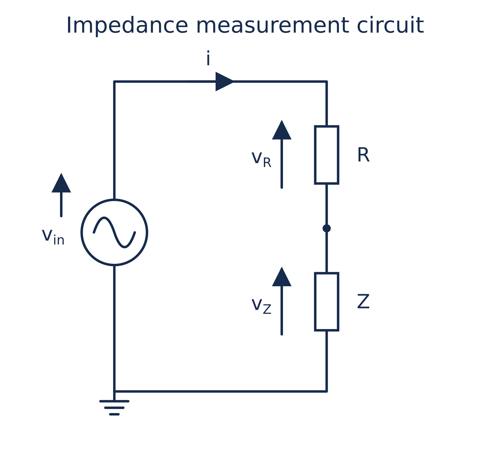

Both probe ground clips must remain at the common ground. Refer to Section 1 for the connection diagrams and examples of poor-quality waveforms.

Start with a 1 kΩ test resistor. As frequency changes, choose $R$ of a similar magnitude to $|Z|$:

- If the voltage across the component is too small or noisy, decrease $R$.
- If the math-channel voltage is too small or poorly resolved, increase $R$.
- If both impedances are small, check that the signal generator is not heavily loaded and that its output remains sinusoidal.
- Record every change of $R$ and use the correct value in your calculation.

Use Section 1's examples to check waveform smoothness, stability and voltage scales. A CH2 signal below about 5 mV RMS may be difficult to resolve, but no single amplitude threshold guarantees accuracy. Magnifying a blocky math trace does not improve the acquired data.

#### Measurement procedure and recording table

Make **one copy of the following table for each of the four known components**: the 1 mH and 100 mH inductors, and the 1 µF and 33 nF capacitors. These are the starting frequencies for each sweep; you will reuse the same data for all subsequent analysis of that component.

1. With the generator output off, connect the component in the position labelled $Z$. Begin with $R=1\,\mathrm{k}\Omega$.
2. Select a sine wave with 0 V DC offset and initially 1 V peak amplitude. Use ×10 probes and DC coupling, as in Section 1. Turn the output on and check the actual waveform on CH1.
3. Set the first frequency in the table. Adjust the timebase to display a few complete cycles. At 1 Hz, a period lasts one second, so allow time for the display and measurements to settle.
4. Check CH2 and the CH1 − CH2 math trace. If either is poorly resolved, adjust the test resistor and channel scales using the guidance above. Turn the output off before changing components.
5. Record the test resistance and both **peak-to-peak voltages**, in volts. Calculate impedance magnitude using $|Z|=R V_{Z,\mathrm{pp}}/V_{R,\mathrm{pp}}$.
6. Move to the next frequency and repeat. Plot the calculated impedance after each reading.
7. Add intermediate frequencies only where needed to resolve a transition, an unexpected reading or a possible resonant peak. Record these additional readings in extra rows.

**Component and nominal value:** __________  
**Voltage convention:** peak-to-peak

| Frequency (Hz) | Test resistance $R$ (Ω) | $V_{Z,\mathrm{pp}}$ (V) | $V_{R,\mathrm{pp}}$ (V) | Measured impedance magnitude (Ω) | Ideal prediction (Ω) |
| --- | --- | --- | --- | --- | --- |
| 1 | | | | | |
| 3.2 | | | | | |
| 10 | | | | | |
| 32 | | | | | |
| 100 | | | | | |
| 320 | | | | | |
| 1000 | | | | | |
| 3200 | | | | | |
| 10000 | | | | | |
| 20000 | | | | | |
| 40000 | | | | | |

Use $2\pi fL$ for the ideal inductor prediction and $1/(2\pi fC)$ for the ideal capacitor prediction. Record any poor-quality readings and the reason; do not invent a value when the signal cannot be measured reliably.

**Limits at very low frequency:** the ideal impedance of a 33 nF capacitor is approximately 4.8 MΩ at 1 Hz. The probe's finite input resistance can then load the component appreciably, and the math-channel voltage may be difficult to resolve. A different test resistor may improve signal balance but cannot remove probe loading. Attempt the listed frequencies, but mark a reading as unreliable if necessary, explain the limitation and continue. You are not required to obtain an accurate value at every frequency.

For the component-characterisation tasks, measure **impedance magnitude only**. The predicted phase plots explain the expected behaviour; you do not need an additional measured phase sweep for each component. For the filter tasks, measure **both magnitude and phase**.

The starting table contains 11 frequencies per component. Do not repeat the sweep for model fitting: use the recorded data. Approximately straight trends between the starting points suggest smooth behaviour, but cannot rule out a narrow feature. Take extra readings when the shape of the graph gives you a reason to do so.

A small visual deviation on logarithmic axes can represent a substantial percentage error. Check unexpected readings rather than dismissing them as experimental inaccuracy. Allow enough time for a stable waveform at low frequencies.

### Characterising two inductors

Measure **1 mH and 100 mH inductors**, using one frequency sweep for each between 1 Hz and 40 kHz. Reuse these measurements for the comparisons and model fitting below.

For the series-resistance model, there are two main regions:

- **Low-frequency resistive region:** when $2\pi fL\ll R_s$, the impedance magnitude is approximately $R_s$. The curve becomes nearly horizontal and the impedance phase approaches 0°.
- **Inductive region:** when $2\pi fL\gg R_s$, the impedance magnitude is approximately $2\pi fL$. The log–log curve has gradient +1 and the phase approaches +90°, provided other parasitic effects remain negligible.

The resistive and inductive contributions are equal at:

$$
f=\frac{R_s}{2\pi L}.
$$

At higher frequencies, inter-winding capacitance may cause departures from this model. Identify where the measured data cease to follow the expected trend rather than assuming that the ideal inductive region continues indefinitely.

Refer to the qualitative comparison above when identifying the regions in your measured curves. You are looking for a resistive plateau, an inductive region and, if it is reached within the measurement range, a departure towards self-resonance.

Estimate $R_s$ from the low-frequency plateau. In the inductive region, estimate $L$ using:

$$
L\approx\frac{|Z_L|}{2\pi f}.
$$

The log–log slope identifies the inductive behaviour; its value of +1 alone does not tell you the inductance. The position of the line, or an actual impedance reading at a known frequency, provides that information.

Adjust $L$ and $R_s$ in your spreadsheet to fit each measured curve. Compare the model and measurements on the same axes and explain where the model works and where it does not.

- [ ] Plot the impedance magnitude of the two inductors and compare with the ideal predictions.
- [ ] Identify the resistive and inductive regions, and any higher-frequency departures.
- [ ] Fit the series-resistance model to the same data and explain the differences between the two components.

### Characterising two capacitors

Measure **1 µF and 33 nF capacitors**, using one frequency sweep for each between 1 Hz and 40 kHz. Use the same measurement procedure and adapt the test resistor as necessary.

For the series-resistance model:

$$
|Z_C|=\sqrt{R_s^2+\left(\frac{1}{2\pi fC}\right)^2}.
$$

- **Capacitive region:** when $1/(2\pi fC)\gg R_s$, the magnitude follows $1/(2\pi fC)$. Its log–log gradient is −1 and its phase is close to −90°.
- **Series-resistance region:** if the capacitive reactance becomes small compared with ESR, the magnitude approaches a resistive floor and the phase approaches 0° in this model.

The capacitors may remain close to ideal throughout the usable measurement range. **You are not required to observe an ESR floor.** If a measured curve appears to flatten, first check the signal quality and test resistance: a measurement limit can resemble a physical plateau.

  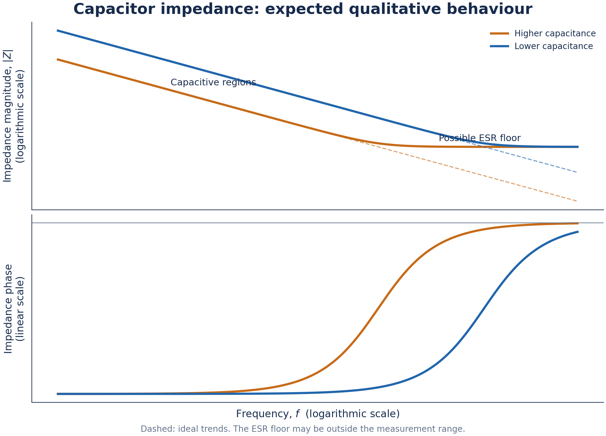

In the capacitive region, estimate capacitance from:

$$
C\approx\frac{1}{2\pi f|Z_C|}.
$$

At the same frequency, a larger capacitance produces a smaller impedance magnitude. Compare the positions of the two measured curves and relate them to the component values.

- [ ] Plot the impedance magnitude of the two capacitors and compare with the ideal predictions.
- [ ] Identify the capacitive regions and use readings from those regions to estimate capacitance.
- [ ] Explain any departures from the ideal curves and compare the behaviour with that of the inductors.

### Finding one unknown inductance with a few readings

Choose **one unmarked inductor**. You do not need to repeat a complete frequency sweep or characterise additional unknown components.

Use a few trial readings to locate a region in which impedance magnitude is approximately proportional to frequency. For example, doubling frequency should approximately double the impedance magnitude. This corresponds to a +1 gradient on log–log axes.

A flat resistive region is also straight on log–log axes, so a straight line alone is not sufficient: you need the **inductive region**, with series resistance small compared with inductive reactance and no significant self-resonant effects.

Once you have located the inductive region, choose a base frequency $f_a$ such that $f_a$, $2f_a$ and $4f_a$ all remain in that region and within the 1 Hz–40 kHz measurement range. Take the following readings. You do not need another full sweep.

| Frequency | Actual frequency (Hz) | Test resistance (Ω) | $V_{Z,\mathrm{pp}}$ (V) | $V_{R,\mathrm{pp}}$ (V) | Impedance magnitude (Ω) | Estimated inductance (H) |
| --- | --- | --- | --- | --- | --- | --- |
| $f_a$ | | | | | | |
| $2f_a$ | | | | | | |
| $4f_a$ | | | | | | |

Calculate inductance for each row using:

$$
L\approx\frac{|Z_L|}{2\pi f}.
$$

The estimates should be reasonably consistent. If they are not, check the waveforms, the choice of test resistor and whether the component is behaving inductively at those frequencies.

- [ ] Estimate the unknown inductance from a few readings and justify your choice of frequencies.
- [ ] Verify the estimate using the LCR bridge, asking a demonstrator for assistance, and return the component afterwards.

### From impedance to filters

A filter changes a signal by passing some frequency components more readily than others. A low-pass filter passes low frequencies and attenuates high frequencies; a high-pass filter does the opposite. For example, an audio system may use a low-pass filter for a subwoofer and a high-pass filter for a tweeter.

Combining a frequency-dependent impedance with a resistor creates a potential divider whose voltage ratio changes with frequency. Its **transfer function** is:

$$
T(j\omega)=\frac{V_\mathrm{out}}{V_\mathrm{in}}.
$$

The transfer function is complex. Its magnitude gives the output-to-input amplitude ratio, and its argument gives the output phase relative to the input.

Unlike the impedance measurement, a filter measurement usually needs no math-channel subtraction: connect CH1 to the input and CH2 to the output, both relative to the same common ground. Place the component across which you measure the output at the grounded end of the divider. Rewire the circuit when changing the output component; do not move a probe ground clip to a non-ground node.

### Which first-order filters should your group build?

There are four first-order configurations illustrated below: RL low-pass, RL high-pass, RC low-pass and RC high-pass. **Each group builds only one RL configuration as the main task, followed by one matching RC configuration if attempting the challenge.**

Use the numerical part of your group identifier to decide. For example, A01 and B03 are odd; A02 and B04 are even.

| Group number | Main first-order task | Matching RC challenge |
| --- | --- | --- |
| Odd | RL low-pass | RC low-pass |
| Even | RL high-pass | RC high-pass |

Both sets of circuit diagrams remain in the handout so that you can understand and compare the two responses. You are not required to build all four circuits. The gain-floor investigation and its RC design challenge are separate tasks, described later.

### Measuring a Bode plot

A Bode plot shows magnitude in decibels and phase in degrees against logarithmic frequency:

$$
G_\mathrm{dB}=20\log_{10}|T|.
$$

A voltage ratio of one is 0 dB. A ratio below one gives a negative value in decibels.

1. Apply a sine wave with 0 V DC offset, initially using the 1 V peak setting from Section 1. Keep the generator setting constant unless adjustment is needed for reliable measurements.
2. Measure the actual input and output amplitudes at each frequency, using the same amplitude convention.
3. Calculate the voltage ratio and its value in decibels.
4. Measure the time difference between corresponding rising zero-crossings of the input and output waveforms. Define $\Delta t=t_\mathrm{out}-t_\mathrm{in}$, using corresponding crossings in the same cycle.
5. Calculate the phase in degrees using:

$$
\phi=-360^\circ f\Delta t.
$$

An output that occurs later than the input has a positive delay and a negative phase. An output that leads the input has a positive phase.

#### Measuring phase by counting divisions

You can also measure phase directly from the oscilloscope grid. Display both sine waves at the same frequency and use corresponding points, such as their rising zero-crossings measured relative to each waveform's own centre line.

1. Count the horizontal divisions between two successive rising zero-crossings of the **input**. This is one complete period.
2. Count the horizontal divisions between corresponding rising zero-crossings of the input and output. Estimate fractions of a division where necessary.
3. Divide the separation by the divisions in one period and multiply by 360°:

$$
|\phi|=\frac{\text{horizontal separation in divisions}}{\text{divisions in one period}}\times360^\circ.
$$

For example, a separation of one division when a period occupies eight divisions gives a phase difference of 45°. If the output occurs to the **right** of the corresponding input crossing, it lags: record **−45°**. If it occurs to the **left**, it leads: record **+45°**. Use crossings belonging to the same cycle rather than adding an extra complete period.

Use horizontal separation, not vertical separation. Both measurements use the same timebase, so the seconds-per-division factor cancels. Cursors can give a more precise reading than counting divisions.

Use the following starting frequencies for a **full filter sweep from 10 Hz to 40 kHz**. Make one copy of this table for your assigned RL configuration and another for the inductive gain-floor circuit. The denser points between 1 kHz and 5 kHz help resolve the transitions in these circuits.

| Frequency (Hz) | Input peak-to-peak voltage (V) | Output peak-to-peak voltage (V) | Magnitude ratio | Gain (dB) | Phase (°) |
| --- | --- | --- | --- | --- | --- |
| 10 | | | | | |
| 100 | | | | | |
| 500 | | | | | |
| 1000 | | | | | |
| 1600 | | | | | |
| 2000 | | | | | |
| 3000 | | | | | |
| 5000 | | | | | |
| 10000 | | | | | |
| 20000 | | | | | |
| 40000 | | | | | |

Add frequencies around a transition only if the starting measurements do not show its shape clearly. Calculate phase using the frequency in hertz and delay in seconds. At low frequencies, adjust the timebase so that complete cycles are visible. When the output approaches the noise floor, its phase may be unreliable; mark such readings rather than treating them as precise results.

Plot magnitude in dB on a linear vertical axis and frequency on a logarithmic horizontal axis. Use a second plot for phase, with the same frequency axis. This differs from the earlier impedance-magnitude plots, where both axes were logarithmic.

Use this procedure for all the filters below. Record the calculated phase directly in the table; a separate time-delay column is not required.

### First-order RL filters

Use **$R_1=1\,\mathrm{k}\Omega$ and $L_1=100\,\mathrm{mH}$**.

#### RL low-pass filter

Connect the inductor between the input and output, and the resistor between the output and ground. The output is measured across the resistor.

  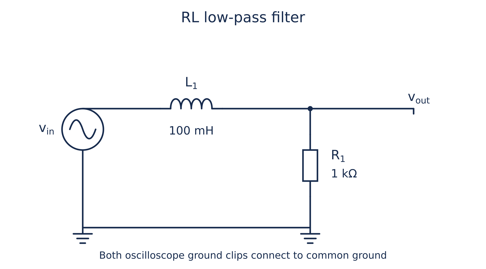

At low frequency, an ideal inductor has a small impedance, so most of the input voltage appears across the resistor. As frequency increases, the inductor's impedance increases and the output falls.

$$
T_\mathrm{LP}(j\omega)=\frac{R_1}{R_1+j\omega L_1}.
$$

#### RL high-pass filter

For the high-pass configuration, connect the resistor between the input and output, and the inductor from the output to ground. Even-numbered groups build this configuration directly; they do not need to build the low-pass circuit first.

  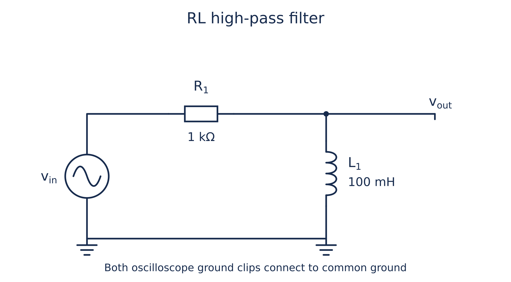

At low frequency, an ideal inductor has a small impedance, so the output is small. At higher frequencies, more of the input voltage appears across the inductor.

$$
T_\mathrm{HP}(j\omega)=\frac{j\omega L_1}{R_1+j\omega L_1}.
$$

For both ideal circuits:

$$
f_c=\frac{R_1}{2\pi L_1}\approx1.59\,\mathrm{kHz}.
$$

At this corner frequency, the magnitude is $1/\sqrt{2}$ of the ideal passband gain, approximately −3 dB. The low-pass phase is −45° and the high-pass phase is +45°.

To identify a measured −3 dB corner, first find the passband gain. Look for a magnitude ratio equal to **0.707 times that passband gain**, or a gain **3 dB below the passband level**. Use the low-frequency passband for a low-pass filter and the high-frequency passband for a high-pass filter. This allows for a passband gain slightly below unity. If a real high-pass filter has a substantial low-frequency floor, a −3 dB crossing may be altered or absent; explain the measured response rather than forcing a corner estimate.

Far into the stopband, the low-pass magnitude falls by approximately 20 dB per decade as frequency increases. The high-pass magnitude rises by approximately 20 dB per decade towards its passband.

  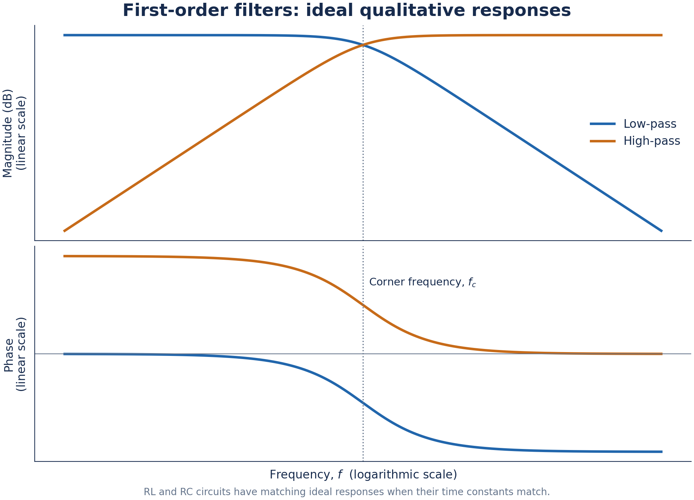

A real inductor has winding resistance. The low-pass gain at low frequency may therefore be less than one, while the high-pass output may approach a non-zero low-frequency floor. Use the series resistance estimated earlier to explain these effects. The ideal transfer functions above do not include winding resistance.

#### Instructions for your assigned RL filter

1. Select the low-pass circuit if your group number is odd, or the high-pass circuit if it is even.
2. With the generator output off, build that circuit using the stated component values.
3. Connect CH1 to the input and CH2 to the output. Connect both probe ground clips to common ground and disable the impedance-measurement math trace.
4. Turn the output on. Check the sine-wave input, then use the full filter-frequency table above to record input voltage, output voltage, gain and phase.
5. Plot magnitude and phase, identify the transition and compare with the prediction for your assigned circuit.
6. If possible, compare plots with a group assigned the other response. Each group should keep its own measurements identified.

- [ ] Build your assigned RL configuration and plot its magnitude and phase response.
- [ ] Compare with the ideal prediction and explain the effect of the inductor's resistance.

### Challenge: reproduce the RL responses with RC filters

**Challenge task:** build only the RC circuit matching your assigned RL response: low-pass for odd-numbered groups and high-pass for even-numbered groups. Compare it with your own RL measurements. The same ideal low-pass and high-pass transfer functions can be obtained using a resistor and capacitor. Because capacitive impedance decreases with frequency, the output component is different from that in the corresponding RL circuit.

Use **$R=10\,\mathrm{k}\Omega$ and $C=10\,\mathrm{nF}$**, giving:

$$
f_c=\frac{1}{2\pi RC}\approx1.59\,\mathrm{kHz}.
$$

For a **low-pass filter**, connect the resistor between input and output and the capacitor from output to ground:

$$
T_\mathrm{LP}(j\omega)=\frac{1}{1+j\omega RC}.
$$

For a **high-pass filter**, connect the capacitor between input and output and the resistor from output to ground:

$$
T_\mathrm{HP}(j\omega)=\frac{j\omega RC}{1+j\omega RC}.
$$

  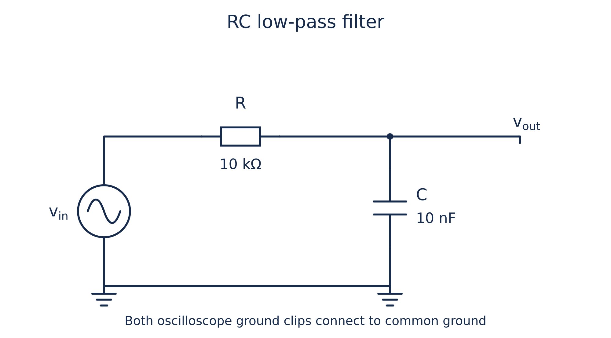

  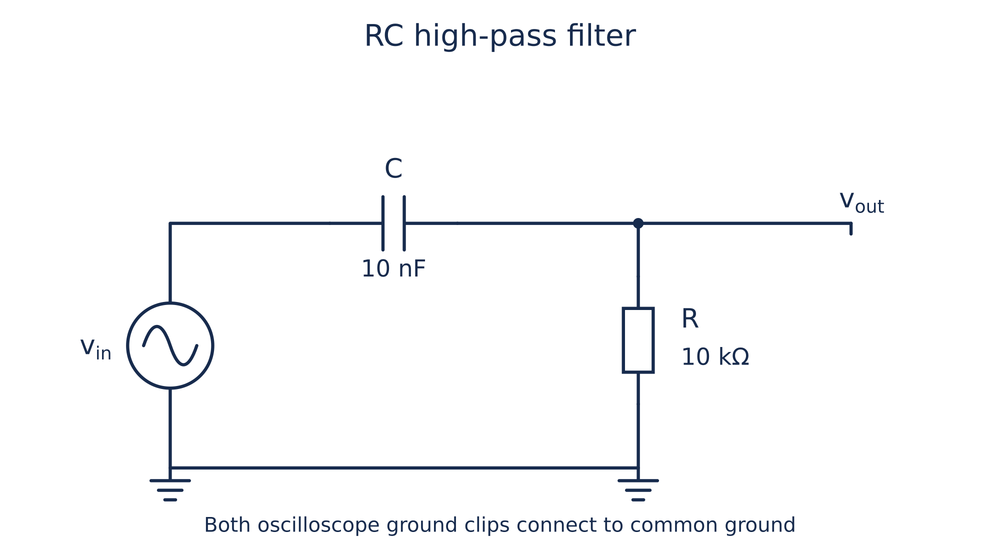

At low frequency, the capacitor approaches an open circuit; at high frequency its impedance becomes small. Use these limiting cases to explain each response before taking measurements.

1. Choose the matching RC diagram using the group-allocation table above.
2. Turn the generator output off, replace the RL network with that RC circuit, and check the ground connections.
3. Connect CH1 to the input and CH2 to the output, then restore the sine-wave signal.
4. Measure at **100 Hz, 1 kHz, 1.6 kHz, 3 kHz and 10 kHz**, using the table below. These points cover frequencies below, near and above the nominal corner.
5. Add your RC measurements to the matching RL magnitude and phase plots. Take extra readings only where they help explain a discrepancy.

| Frequency (Hz) | Input peak-to-peak voltage (V) | Output peak-to-peak voltage (V) | Magnitude ratio | Gain (dB) | Phase (°) |
| --- | --- | --- | --- | --- | --- |
| 100 | | | | | |
| 1000 | | | | | |
| 1600 | | | | | |
| 3000 | | | | | |
| 10000 | | | | | |

- [ ] Build your matching RC configuration and compare its selected magnitude and phase measurements with your assigned RL response.
- [ ] Explain why the ideal responses match and why the real circuits may differ.

### A filter with a gain floor

An ordinary low-pass filter's gain tends towards zero at high frequency. Sometimes we want the gain to approach a fixed, non-zero value instead. This is a **shelving response**: the magnitude moves between two plateaus.

All groups investigate the following gain-floor circuit:

- $L_1=100\,\mathrm{mH}$ in parallel with $R_1=3\,\mathrm{k}\Omega$ forms the first part of the upper divider arm.
- $R_3=1\,\mathrm{k}\Omega$ connects this parallel combination to the output.
- $R_2=1\,\mathrm{k}\Omega$ connects the output to ground.

  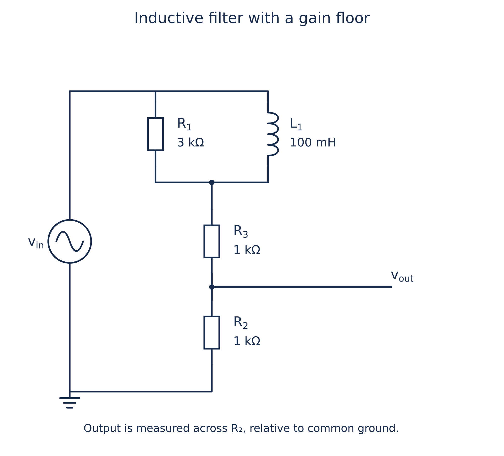

At low frequency, an ideal inductor behaves approximately as a short circuit, bypassing $R_1$. The limiting gain is:

$$
T(0)=\frac{R_2}{R_3+R_2}=0.5.
$$

At high frequency, the inductor's impedance is large and the upper arm approaches $R_1+R_3$. The limiting gain is:

$$
T(\infty)=\frac{R_2}{R_1+R_3+R_2}=0.2.
$$

These limits illustrate how the DC and high-frequency behaviour of reactive components can simplify a circuit before any algebra is needed. At the finite frequencies available in the experiment, the measured gains should approach these ideal limits; they need not equal them exactly. Winding resistance and other parasitic properties may also shift the measured plateaus.

The parallel combination has impedance:

$$
Z_p=\frac{R_1j\omega L_1}{R_1+j\omega L_1}.
$$

Apply the potential-divider relationship to obtain:

$$
T(j\omega)=\frac{R_2}{R_2+R_3+Z_p}.
$$

This shelving response has **two break frequencies**, one associated with a pole and one with a zero. Writing it in the form used for Bode plots:

$$
T(j\omega)=0.5\frac{1+j\omega/\omega_z}{1+j\omega/\omega_p},
$$

where:

$$
\omega_p=\frac{R_1(R_2+R_3)}{L_1(R_1+R_2+R_3)},
\qquad
\omega_z=\frac{R_1}{L_1}.
$$

For these component values, $f_p\approx1.91\,\mathrm{kHz}$ and $f_z\approx4.77\,\mathrm{kHz}$. The pole begins the downward transition and the zero levels it out towards the high-frequency gain floor. There is no single −3 dB corner that describes the whole shelving response.

The phase is negative through the transition and approaches zero at both frequency extremes in the ideal model.

  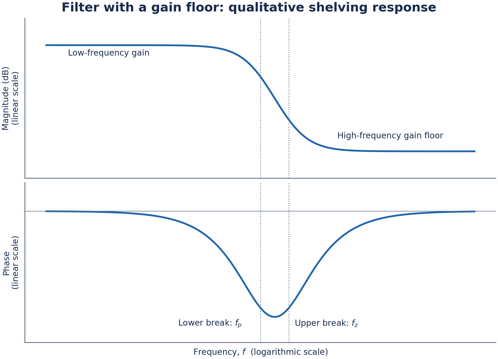

- [ ] Derive the transfer function from the parallel-impedance and potential-divider equations, and check the limiting gains.

Before measuring:

1. Turn off the generator output and build the circuit shown, checking the parallel connection of $R_1$ and $L_1$.
2. Connect CH1 to the input and CH2 to the junction of $R_3$ and $R_2$. Both probe ground clips go to common ground.
3. Restore the sine wave and check that neither channel clips.
4. Use a fresh copy of the full filter table above and take readings at its listed frequencies.
5. Plot gain and phase and compare the low- and high-frequency plateaus with the predictions.

- [ ] Build the circuit and measure its magnitude and phase response from 10 Hz to 40 kHz.
- [ ] Compare the results with the ideal prediction. Explain how winding resistance can change the low-frequency plateau.

### Challenge: reproduce the gain floor with an RC circuit

Design and build a passive circuit using **resistors and one capacitor** with the following ideal response:

| Requirement | Target |
| --- | --- |
| Low-frequency voltage gain | 0.5 |
| High-frequency voltage gain | 0.2 |
| Lower break frequency | Approximately 1.91 kHz |
| Upper break frequency | Approximately 4.77 kHz |

The four targets are linked by the first-order shelving transfer function; they are not independent specifications.

Use the capacitor's low- and high-frequency limiting behaviour to choose its position. A capacitor becomes an open circuit at DC and has a small impedance at high frequency. Consider placing a capacitor in parallel with a resistor in the lower arm of a potential divider, while retaining sufficient resistance in that arm to give a non-zero high-frequency gain.

Choose the component values yourself. Use available preferred values or sensible series/parallel combinations, and calculate the resulting gains and break frequencies. Check your prediction in LTspice once it has been introduced in the problem classes.

- [ ] Draw your circuit and show how its limiting gains and break frequencies meet the specification.
- [ ] Build it and measure at **100 Hz, 1 kHz, 2 kHz, 3 kHz, 5 kHz, 10 kHz and 40 kHz**, using the filter recording-table columns above. Compare with the inductive circuit's measurements at those same frequencies.
- [ ] Add measurements where needed to investigate differences, then explain the effect of component tolerances and parasitic resistance.

[Continue to Section 3: Resonance and Filters](Section3.md).
