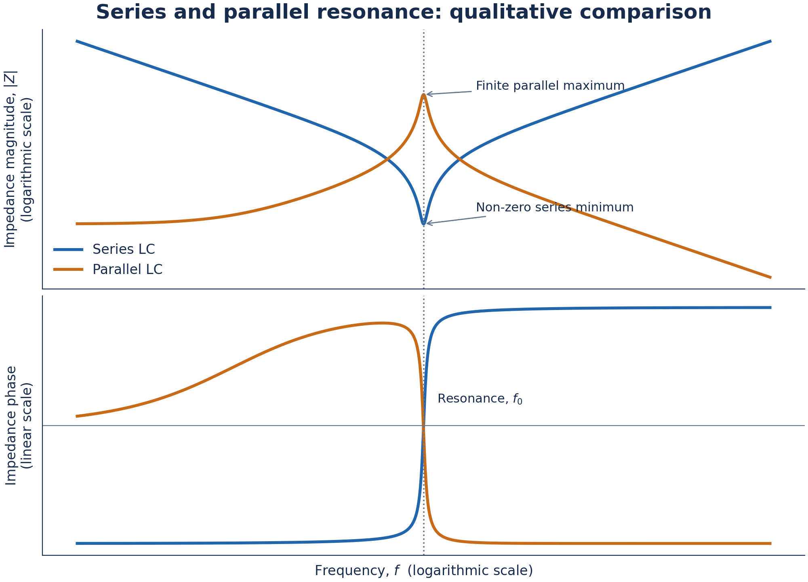
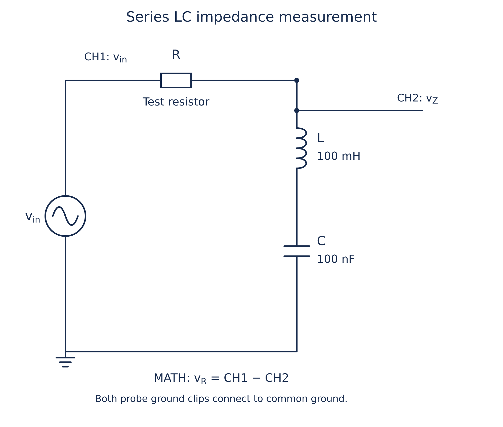
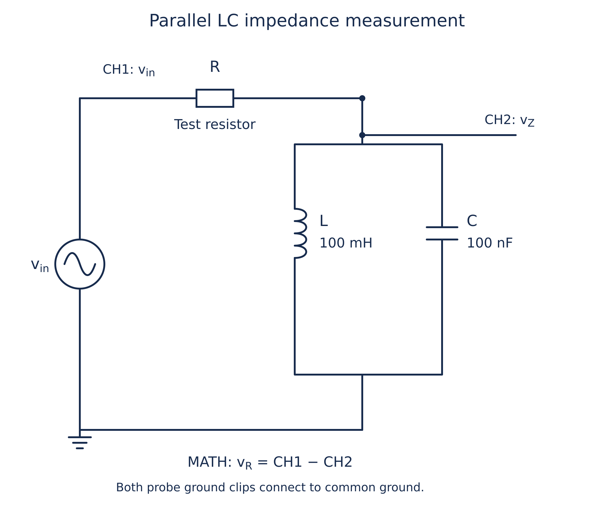
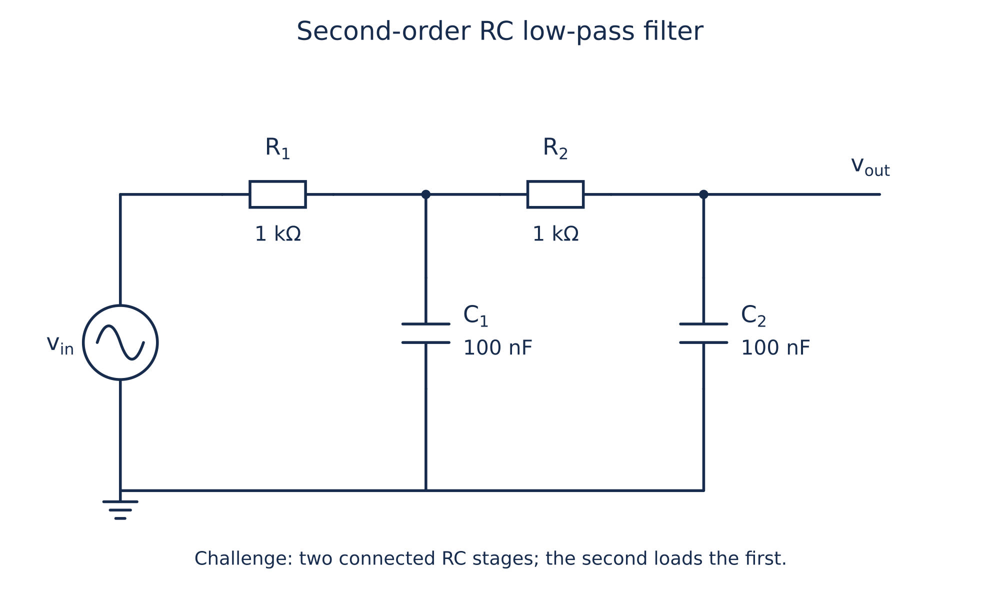
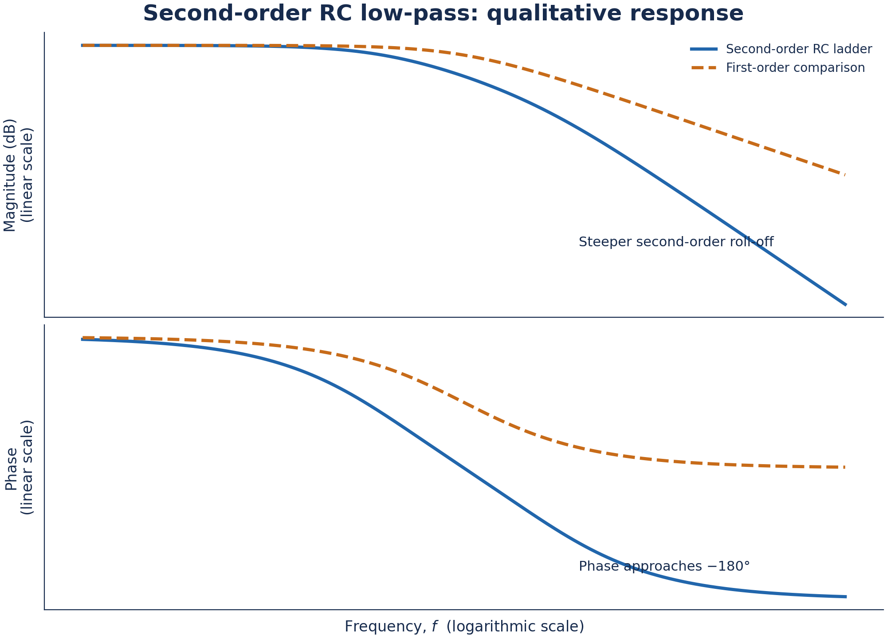
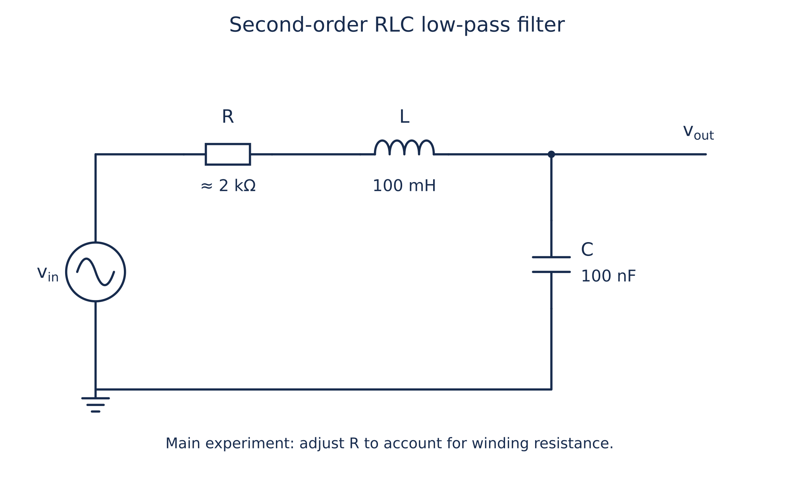
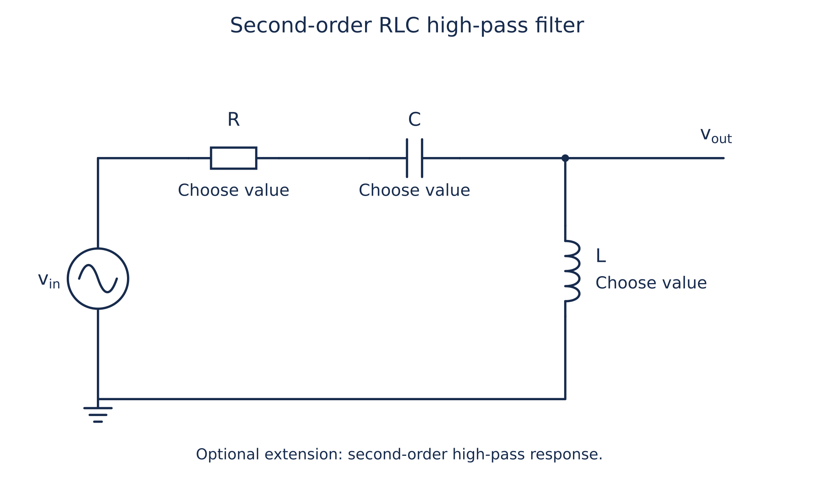
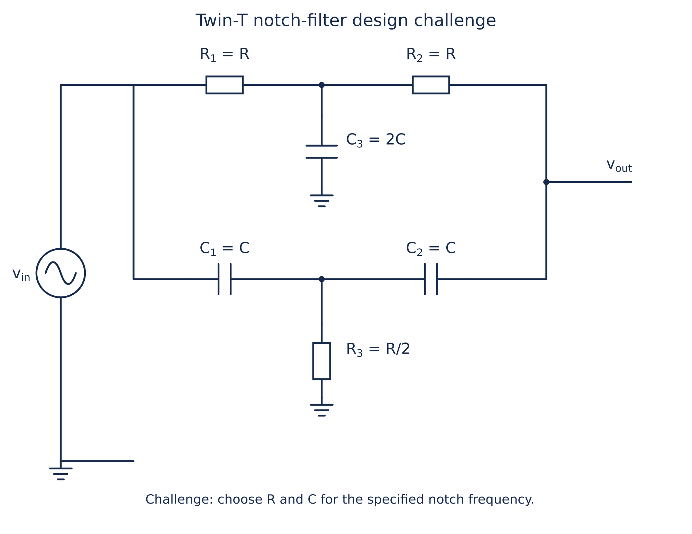
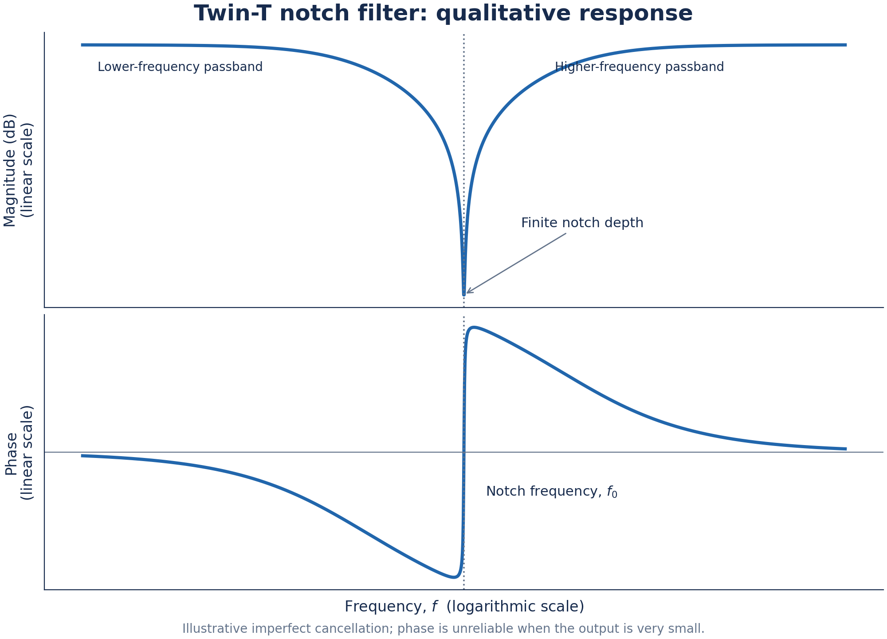

# Analysis and Design of Circuits Lab
# Part 1: Autumn Term weeks 4–6

## Section 3: Resonance and Second-Order Filters

In Section 2, you investigated individual capacitors and inductors and used them to build first-order filters. You will now connect an inductor and capacitor together and investigate **series and parallel resonance**. The final challenges extend the filter work to second-order circuits, including a two-stage RC low-pass filter and a Twin-T notch filter.

Complete the resonance measurements first. The tasks labelled **Challenge** extend the main investigation. Keep your measurements and analysis together: do not repeat a complete sweep simply to produce a second plot.

### Before the lab

1. Revise the capacitor and inductor impedance equations from Section 2.
2. Calculate the ideal resonant frequency for $L=100\,\mathrm{mH}$ and $C=100\,\mathrm{nF}$ using the equation below.
3. Sketch the expected series and parallel impedance trends and identify which should have a minimum and which should have a maximum.
4. Prepare the measurement table below in your spreadsheet.
5. If attempting a filter challenge, calculate its expected response before building it. Use LTspice once it has been introduced in the problem classes.

### What is resonance?

An ideal inductor has impedance $j\omega L$, while an ideal capacitor has impedance $-j/(\omega C)$. Their reactances have opposite signs. At a particular frequency their magnitudes are equal:

$$
\omega_0L=\frac{1}{\omega_0C}.
$$

Therefore:

$$
\omega_0=\frac{1}{\sqrt{LC}},
\qquad
f_0=\frac{1}{2\pi\sqrt{LC}}.
$$

Remember that $\omega_0$ is in radians per second and $f_0$ is in hertz. For 100 mH and 100 nF, the ideal prediction is approximately **1.59 kHz**.

In an ideal series connection the impedances cancel, giving zero impedance at resonance. In an ideal parallel connection the branch admittances cancel, giving an unbounded impedance magnitude. Real components have losses, so the measured minimum is not zero and the maximum is not infinite.

This resonance comes from connecting the separate capacitor and inductor together. It is different from an individual inductor's **self-resonance**, which involves its unwanted inter-winding capacitance.

  

### Series LC network

Connect a **100 nF capacitor and 100 mH inductor in series**. Together, they replace $Z$ in the impedance-measurement divider from Sections 1 and 2. The external test resistor $R$ remains in series with this network.

  

For ideal components:

$$
Z_\mathrm{series}=j\omega L+\frac{1}{j\omega C}=j\left(\omega L-\frac{1}{\omega C}\right).
$$

Below resonance, the capacitive reactance is larger in magnitude, so the network behaves predominantly capacitively. Above resonance, inductive reactance dominates. At resonance the imaginary terms cancel.

If the total component series resistance is $R_s$, a more realistic model is:

$$
Z_\mathrm{series}=R_s+j\left(\omega L-\frac{1}{\omega C}\right).
$$

The impedance magnitude reaches a minimum close to $R_s$. This gives a physical explanation for the non-zero minimum: reactance can cancel, but the resistance of the wire and component losses remain.

#### Measuring the series network

1. Build the circuit with the generator output off. Begin with a 1 kΩ test resistor.
2. Connect CH1 to the input, CH2 across the complete LC network, and both ground clips to the common ground. Set MATH to CH1 − CH2.
3. Use ×10 probes, DC coupling and a sine wave with 0 V offset. Initially use the 1 V peak generator setting from Section 1 and check the actual input waveform.
4. Take readings at the frequencies in the table below. Measure both voltages peak-to-peak and calculate $|Z|=R V_{Z,\mathrm{pp}}/V_{R,\mathrm{pp}}$.
5. Plot each point immediately. Near resonance, the LC voltage may become small; adapt $R$ using the guidance in Section 1. Check for heavy loading or distortion before reducing it further.
6. Add closely spaced frequencies around the minimum until its position and shape are clear. Do not assume that the nominal 1.59 kHz prediction is the exact measured resonant frequency.

### Recording the resonance measurements

Make one copy of this table for the series network and one for the parallel network. Use the **same inductor and capacitor** for both.

| Frequency (Hz) | Test resistance $R$ (Ω) | Network voltage $V_{Z,\mathrm{pp}}$ (V) | Resistor voltage $V_{R,\mathrm{pp}}$ (V) | Impedance magnitude (Ω) |
| --- | --- | --- | --- | --- |
| 100 | | | | |
| 300 | | | | |
| 600 | | | | |
| 1000 | | | | |
| 1300 | | | | |
| 1500 | | | | |
| 1600 | | | | |
| 1700 | | | | |
| 2000 | | | | |
| 3000 | | | | |
| 6000 | | | | |
| 10000 | | | | |
| 40000 | | | | |

Add rows for the extra frequencies chosen around the minimum or maximum. Record any change in test resistance and do not use readings that are dominated by noise.

- [ ] Plot the series-network impedance magnitude against frequency on logarithmic axes and compare it with theory.
- [ ] Identify the minimum, estimate its frequency and explain why its impedance is not zero.
- [ ] Explain the predominantly capacitive and inductive regions on either side.

### Parallel LC network

Reconnect the **same 100 nF capacitor and 100 mH inductor in parallel**, so that the complete parallel combination now forms $Z$ in the measurement circuit.

  

Using the equation for impedances in parallel:

$$
Z_\mathrm{parallel}=\frac{Z_LZ_C}{Z_L+Z_C}.
$$

For ideal components this becomes:

$$
Z_\mathrm{parallel}=\frac{j\omega L}{1-\omega^2LC}.
$$

As frequency approaches the ideal resonant frequency, the denominator approaches zero and the **impedance magnitude** grows without bound. The complex impedance itself does not tend to a positive real infinity; its reactive sign changes across resonance.

Another way to understand this is to add the branch admittances. At resonance the ideal capacitive and inductive branch currents are equal and opposite, so their sum at the input is zero, even though current can circulate between the two branches.

Real losses prevent complete cancellation of the input current, limiting the impedance peak. Probe loading can also lower the measured peak. The frequency of the real peak may differ slightly from the ideal prediction and from the series-network minimum.

Below resonance, the ideal parallel network is predominantly inductive. Above resonance, it is predominantly capacitive—the opposite ordering to the series network.

#### Measuring the parallel network

1. Turn the generator output off and rewire the components in parallel.
2. Retain the input, network-voltage and math-channel measurements used above, with both probe grounds at common ground.
3. Use the same starting frequencies and a fresh copy of the recording table.
4. Near the impedance peak, the voltage across the test resistor may become small. Increase $R$ if necessary to obtain a reliable math-channel signal.
5. Add readings around the maximum to locate it and resolve its shape.
6. Overlay the parallel-network measurements on the series-network plot and compare both with the ideal predictions.

- [ ] Identify the maximum impedance magnitude and explain why it is finite.
- [ ] Compare the measured resonant frequencies with each other and the ideal prediction.
- [ ] Explain why one connection gives an impedance minimum while the other gives a maximum.

### From resonance to second-order filters

A transfer function relates output voltage to input voltage:

$$
T(j\omega)=\frac{V_\mathrm{out}}{V_\mathrm{in}}.
$$

Its magnitude is the voltage-amplitude ratio and its phase is the output phase relative to the input. Measure CH1 at the input and CH2 at the output, both relative to common ground. For these filter measurements, the math-channel impedance calculation is no longer needed.

The first-order filter explanations and experiments are in Section 2. The following challenges extend those ideas. A second-order low-pass or high-pass response can have a stopband slope of 40 dB per decade, compared with 20 dB per decade for a first-order response. A second-order low-pass phase can approach −180°.

A circuit containing two reactive components does not automatically have the same response as every other second-order circuit. Their connection and damping determine the shape.

### Challenge: second-order RC low-pass filter

Build the two-stage RC ladder investigated in Adam's measurements, using:

$$
R_1=R_2=1\,\mathrm{k}\Omega,
\qquad
C_1=C_2=100\,\mathrm{nF}.
$$

Use these component values for the experiment; they give the intended frequency range for the comparison.

Connect $R_1$ from the input to the first node and $C_1$ from that node to ground. Connect $R_2$ from the first node to the output, and $C_2$ from the output to ground.

  

At low frequency, both capacitors have large impedances, little current flows through the resistors, and the output approaches the input. At high frequency, the capacitors increasingly shunt the signal to ground and the output falls.

The second stage loads the first. Therefore the complete transfer function is **not** simply the product of two isolated identical RC responses. For equal resistors and capacitors, with a negligible additional output load:

$$
T(s)=\frac{1}{1+3sRC+s^2R^2C^2},
\qquad s=j\omega.
$$

The component time constant gives $1/(2\pi RC)\approx1.59\,\mathrm{kHz}$, but this is **not the −3 dB frequency of the loaded ladder**. Its −3 dB point is approximately 0.374 times this value, about 596 Hz.

  

1. Predict the response in LTspice using the complete connected circuit.
2. Build the ladder and connect CH1 to its input and CH2 to its output.
3. Measure at the frequencies in the filter table below, adding points around the measured transition if needed.
4. Plot magnitude in dB and phase against logarithmic frequency, following Section 2's measurement method.
5. Compare with the simulation and explain the loading effect. At high frequency, mark readings that approach the noise floor rather than assuming their phase is reliable.

### Filter measurement table

Use this table for the RC ladder. It can also be adapted for the RLC and notch challenges. There is no separate time-delay column; record the calculated phase directly.

| Frequency (Hz) | Input peak-to-peak voltage (V) | Output peak-to-peak voltage (V) | Magnitude ratio | Gain (dB) | Phase (°) |
| --- | --- | --- | --- | --- | --- |
| 10 | | | | | |
| 100 | | | | | |
| 300 | | | | | |
| 600 | | | | | |
| 1000 | | | | | |
| 1600 | | | | | |
| 3000 | | | | | |
| 6000 | | | | | |
| 10000 | | | | | |
| 20000 | | | | | |
| 40000 | | | | | |

- [ ] Compare the second-order roll-off with the first-order filters from Section 2.
- [ ] Explain why cascading unbuffered stages changes the response compared with two isolated stages.

### Challenge: design and test a second-order RLC filter

A resistor, capacitor and inductor can form a second-order low-pass or high-pass filter. In the appropriate stopband, their transfer-function magnitudes vary as $1/f^2$ or $f^2$, respectively.

  

  

This retains the existing RLC design challenge. Use the type and target frequency listed for your pair at the end of this handout. Choose components from the available-parts tables and use the lecture notes to select resistance for critical damping, $\zeta=1$. Include winding resistance in your assessment of the real damping.

Be clear which frequency your design calculation describes. The natural frequency $f_n=1/(2\pi\sqrt{LC})$ is not generally the −3 dB frequency. For an ideal critically damped low-pass, $f_{-3\mathrm{dB}}\approx0.644f_n$; for its high-pass counterpart, $f_{-3\mathrm{dB}}\approx1.554f_n$. For this challenge, interpret the table's target $f_c$ as the **−3 dB corner frequency**.

1. Select the circuit topology and calculate values that place the −3 dB corner within 10% of your assigned target.
2. Simulate the complete circuit in LTspice and check both magnitude and phase.
3. Build it and measure selected frequencies below, near and above the target, within 10 Hz–40 kHz. Choose extra points where needed to identify its roll-off.
4. Plot the measurements with the simulation and explain discrepancies, including component tolerances, winding resistance and measurement limits.

- [ ] Present your circuit, component choices, predicted response and measured comparison.

### Challenge: build a Twin-T notch filter

A notch, or band-stop, filter rejects a band around a particular frequency while passing lower and higher frequencies. It is useful for suppressing an unwanted tone. This differs from a band-pass filter, which passes frequencies around its centre and attenuates those away from it.

Use the **Twin-T topology from Adam's work**: two T networks connected in parallel between input and output. One T has two series resistors and a midpoint capacitor to ground; the other has two series capacitors and a midpoint resistor to ground.

  

For the balanced ideal circuit:

$$
R_1=R_2=R,\quad R_3=R/2,\qquad C_1=C_2=C,\quad C_3=2C,
$$

and:

$$
f_0=\frac{1}{2\pi RC}.
$$

Design for a notch frequency of approximately **1.6 kHz**, choosing components from the available-parts list. The two paths cancel at the ideal notch frequency. Component mismatch, source and load effects, and measurement noise limit the depth of a real notch.

  

1. Choose $R$ and $C$ and obtain the balancing values $R/2$ and $2C$. Use series or parallel combinations where they improve the match.
2. Calculate the predicted notch frequency and simulate the circuit.
3. Build it and connect CH1 to the input and CH2 to the output, with both grounds at common ground.
4. Begin at **100, 300, 600, 1000, 1200, 1400, 1600, 1800, 2000, 2400, 3000, 6000, 10000 and 40000 Hz**. Use the filter table columns above.
5. Add finer frequency steps near the minimum to find its location and depth. A very small output makes the phase unreliable; at an ideal zero-output notch, output phase is undefined.
6. Compare the measured response with the simulation and explain any difference in notch frequency or depth.

- [ ] Show your selected component values and the measured notch response.
- [ ] Explain how cancellation produces the notch and why the measured output does not reach exactly zero.

### Available components

**Resistors ( $\times10^0\Omega$ to $\times10^6\Omega$ )**

|    |    |    |    |
| -- | -- | -- | -- |
| 1.0 | 1.1 | 1.2 | 1.3 |
| 1.5 | 1.6 | 1.8 | 2.0 |
| 2.2 | 2.4 | 2.7 | 3.0 |
| 3.3 | 3.6 | 3.9 | 4.3 |
| 4.7 | 5.1 | 5.6 | 6.2 |
| 6.8 | 7.5 | 8.2 | 9.1 |

**Capacitors (multilayer ceramic)**

|    |    |    |    |
| -- | -- | -- | -- |
| 1nF | 2.2nF | 4.7nF | 10nF |
| 22nF | 33nF | 47nF | 68nF |
| 100nF | 220nF | 470nF | 1μF |

**Inductors**

|    |    |    |
| -- | -- | -- |
| 1mH | 2.2mH | 3.3mH |
| 4.7mH | 10mH | 22mH |
| 33mH | 47mH | 100mH |

## Specifications for the RLC design challenge

Each lab pair has a specified filter type and corner frequency for their RLC filter.

| Pair | Type | $f_c$ (Hz) |
| -- | -- | -- |    			
A01|	LP|	1900
A02|	HP|	8700
A03|	HP|	7400
A04|	HP|	1800
A05|	HP|	8800
A06|	HP|	1900
A07|	HP|	8800
A08|	HP|	5000
A09|	HP|	2800
A10|	LP|	2700
A11|	HP|	2300
A12|	LP|	1900
A13|	HP|	4900
A14|	HP|	5000
A15|	HP|	5300
A16|	LP|	5900
A17|	LP|	7400
A18|	LP|	7300
A19|	HP|	4100
A20|	HP|	1700
A21|	LP|	7400
A22|	HP|	5900
A23|	LP|	3400
A24|	LP|	1600
A25|	HP|	8700
A26|	HP|	8800
A27|	HP|	3400
A28|	LP|	8800
A29|	LP|	8700
A30|	LP|	970
A31|	HP|	730
A32|	LP|	3400
A33|	HP|	3400
A34|	HP|	5900
A35|	LP|	4000
A36|	HP|	3400
A37|	LP|	1700
A38|	LP|	8700
A39|	LP|	5100
A40|	HP|	4000
A41|	LP|	3400
A42|	HP|	5900
A43|	HP|	4000
A44|	HP|	1900
A45|	HP|	4900
A46|	HP|	5900
A47|	LP|	2800
A48|	LP|	6600
A49|	HP|	2300
A50|	HP|	6100
A51|	LP|	5000
A52|	LP|	5900
A53|	LP|	7300
A54|	HP|	8900
A55|	LP|	2800
B01|	LP|	4500
B02|	LP|	7400
B03|	LP|	3400
B04|	HP|	1400
B05|	LP|	6100
B06|	LP|	1900
B07|	HP|	1600
B08|	LP|	1600
B09|	LP|	4400
B10|	HP|	1700
B11|	HP|	1100
B12|	LP|	4900
B13|	LP|	5900
B14|	LP|	1900
B15|	LP|	2300
B16|	HP|	2300
B17|	LP|	4400
B18|	HP|	5900
B19|	HP|	8900
B20|	HP|	7400
B21|	HP|	8800
B22|	LP|	5300
B23|	HP|	1100
B24|	HP|	4900
B25|	HP|	7300
B26|	LP|	2800
B27|	LP|	4400
B28|	LP|	2000
B29|	LP|	2300
B30|	LP|	5000
B31|	HP|	1500
B32|	HP|	5100
B33|	HP|	2300
B34|	LP|	2300
B35|	LP|	3400
B36|	LP|	4900
B37|	HP|	3400
B38|	HP|	3300
B39|	LP|	2400
B40|	LP|	3300
B41|	HP|	2300
B42|	LP|	5100
B43|	LP|	2700
B44|	LP|	5000
B45|	LP|	3400
B46|	LP|	4800
B47|	LP|	5900
B48|	HP|	8700
B49|	HP|	1100
B50|	HP|	7300
B51|	HP|	7300
B52|	LP|	2100
B53|	LP|	8800
B54|	LP|	1400
B55|	HP|	5900

*HP: High-pass, LP: Low-pass*
