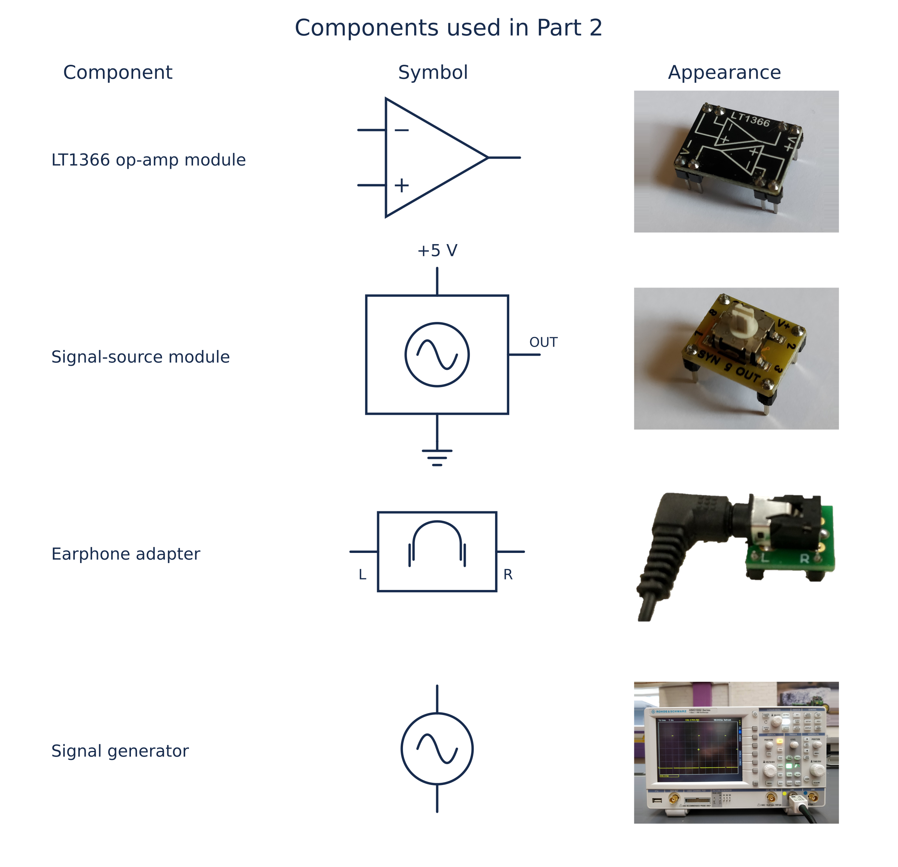
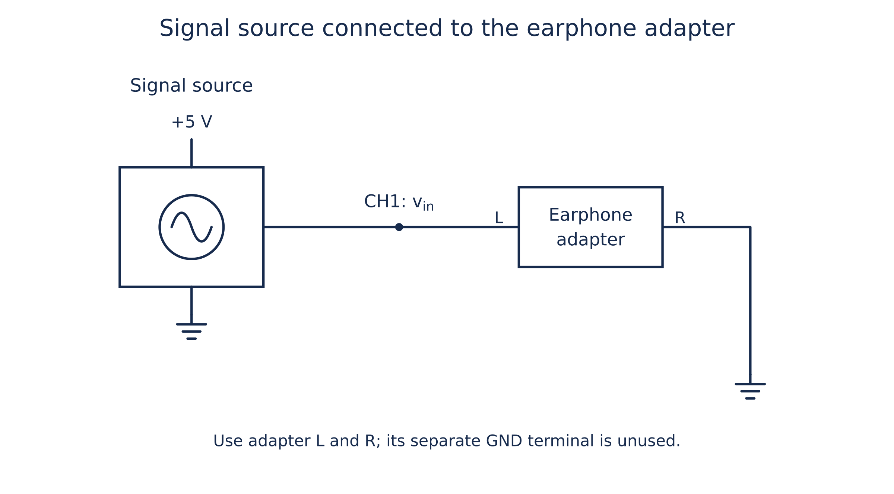
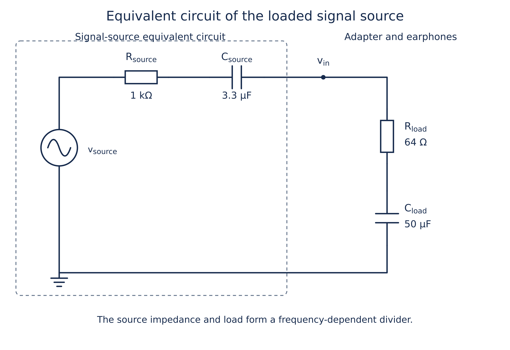

# Analysis and Design of Circuits Lab
# Part 2: Autumn Term weeks 8–10

## Section 1: Amplification, Supply Rails and Biasing

### Why do we need an amplifier?

A signal source can produce a clearly visible voltage on an oscilloscope but still give a very quiet sound when connected to earphones. The important question is not only **how much voltage the source produces without a load**, but also **whether it can maintain that voltage while supplying current to the load**.

An oscilloscope probe has a high input impedance and draws very little current. Earphones have a much lower impedance and draw more current. The signal-source module is not an ideal voltage source: its internal output impedance forms a potential divider with the earphones. Once the earphones are connected, some of the source voltage is dropped inside the source, so less voltage appears across the earphones.

For example, an approximately 64 Ω earphone load connected to a source with 1 kΩ internal resistance receives only about $64/(1000+64)\approx0.06$ of the internal source voltage when coupling-capacitor reactances are negligible. A small output voltage does not necessarily mean that the source generates a weak signal internally; it may mean that the source is being heavily loaded.

An amplifier placed between the source and the earphones can help in three ways:

1. **Reduce loading of the source.** An input impedance appreciably higher than the earphone impedance draws less current from the source and allows more of its voltage to reach the amplifier input. The input impedance depends on the amplifier circuit; an inverting amplifier does not have an infinite input impedance just because the op-amp itself draws very little signal-input current.
2. **Supply the load current.** A sufficiently low output impedance and adequate output-current capability allow the amplifier to maintain a useful voltage across the earphones.
3. **Provide voltage gain if needed.** The output signal can have a larger voltage amplitude than the signal at the amplifier input, within the limits set by its supply rails, bandwidth and load.

The additional output energy comes from the **amplifier's power supply**. The input signal controls that energy; the amplifier does not create energy from the signal. A voltage follower can help drive a load even with a voltage gain of one, showing that amplification is not only about increasing voltage.

In the first activity, you will observe the loading effect directly. You will then build an amplifier and investigate how its power supply determines the output voltages it can reproduce.

### What you will do

1. Compare the signal source with and without the earphone load.
2. Set up +5 V, 0 V and −5 V using the desk supply.
3. Build and measure a dual-supply inverting amplifier, which can reproduce both halves of a zero-centred signal.
4. Change to a single +5 V/0 V supply and observe why the same unbiased circuit clips.
5. Add a 2.5 V bias and input coupling capacitor so that the single-supply inverting circuit works correctly.
6. Build the biased single-supply non-inverting circuit and explain its DC and AC behaviour separately.
7. If time permits, build the single-supply audio mixer as a challenge.

Allow approximately one session for this section and one for Section 2, leaving the remaining session for catch-up and oral preparation. Complete the numbered activities before the challenge. Record circuits, measurements and explanations in your lab book.

### Recognising the symbols and module connections

The op-amp symbol is the triangle shown in the middle column above. The **− input** is the inverting signal input; the **+ input** is the non-inverting signal input. These are different from the supply pins, **V+ and V−**, shown separately on the redrawn circuits. All circuits use this same symbol convention.

The LT1366 module contains two op-amps sharing the same supply rails. Use the markings on the module to identify its inputs, outputs and supplies; a schematic symbol is not a physical pin layout. Keep the circuit unpowered while changing connections.

An ideal op-amp draws no signal-input current. With negative feedback and an output operating within its limits, it drives its output so that its two signal inputs are approximately equal. This approximation does not hold when the output is clipped or the feedback is incorrectly connected.

Real op-amps have finite bandwidth, output-current capability and output swing. Refer to the [LT1366 datasheet](https://www.analog.com/media/en/technical-documentation/data-sheets/1366fb.pdf). The available output swing depends on load; do not assume that an output can reach either supply rail exactly. Use the module's existing supply decoupling; if using a bare IC, ask the demonstrator about the required bypass capacitors and unused amplifier connection.

### Signal source and earphones

The signal-source module needs **+5 V and ground** in this experiment, even when the op-amp uses ±5 V. Its OUT pin provides the signal, and SYN synchronises two modules when required. Use the yellow source module for tasks requiring one source.

| Mode | Signal |
| --- | --- |
| 0 | Sine wave |
| 1 | Noisy sine wave |
| 2 | Music melody |
| 3 | Music bass |
| 4–7 | Unused |
| 8 | Melody with unwanted whine |
| 9 | Ground |

The earphone adapter connects the two nominal 32 Ω earphones in series, giving approximately 64 Ω, and includes output coupling capacitors (approximately 50 µF equivalent series capacitance). Use its **L and R terminals as shown**; its separate GND terminal is unused in this series connection. The adapter blocks amplifier DC bias from reaching the earphones. Never substitute a direct connection that applies the 2.5 V bias across the earphones.

Begin electrical measurements with the earphones disconnected. Check the output waveform before connecting them, and start listening at low signal amplitude. A load can change the gain or cause current-limited distortion even if the unloaded waveform is correct.

### Before the lab

1. Revise the inverting gain $A_v=-R_\mathrm{fb}/R_\mathrm{in}$ and the non-inverting gain $A_v=1+R_\mathrm{fb}/R_g$.
2. For $R_\mathrm{in}=1.5\,\mathrm{k}\Omega$, choose an available feedback resistance giving an inverting gain within 5% of −1.5.
3. Calculate the unloaded midpoint voltage of two equal resistors connected between +5 V and ground.
4. Explain why a voltage near −1 V can be reproduced with ±5 V supplies but cannot be reproduced with +5 V and 0 V supplies.

### Activity 1: observe signal-source loading

1. Power the signal-source module from +5 V and ground. Select mode 0.
2. With the earphones disconnected, measure its OUT voltage peak-to-peak at CH1.
3. Connect the earphones through the adapter as shown, measure the voltage again and listen briefly at low level.
4. Record the change and explain it using the equivalent circuit below.

| Condition | Source-output peak-to-peak voltage (V) | Observation |
| --- | --- | --- |
| Earphones disconnected | | |
| Earphones connected through adapter | | |

The source is modelled by an internal voltage source, a 1 kΩ source resistance and a 3.3 µF series capacitor. Current drawn by the earphones causes voltage drops across the **source resistance and source capacitor**, reducing the terminal voltage. At frequencies where both coupling-capacitor reactances are negligible, the resistive divider predicts a loaded-to-unloaded voltage ratio of approximately $64/(1000+64)$.

Compare the measured loaded-to-unloaded ratio with the resistive-divider prediction. If they differ, consider capacitor reactance, the approximate earphone impedance and measurement uncertainty. This loading result motivates the amplifier you will build next.

### Activity 2: set up a dual ±5 V supply

The desk supply must provide **two isolated outputs that can be connected in series**, or a supported ± tracking arrangement. Ask the demonstrator to identify the correct terminals and mode on your bench model. Do not assume that every terminal marked “−” is a −5 V output or that the earth terminal is the midpoint.

<!-- Figure to redraw: bench_dual_supply.png. Use the agreed symbol style and the supply, bias and component values specified in this text. -->

1. Turn the supply outputs off and disconnect the op-amp.
2. Set each isolated output to **5.0 V**. The two individual displays can both read positive 5 V.
3. Join the **negative terminal of output A** to the **positive terminal of output B**. This junction is the circuit's **0 V common ground**.
4. Output A's remaining positive terminal is **+5 V** relative to the junction. Output B's remaining negative terminal is **−5 V** relative to it.
5. With the circuit still disconnected, turn the outputs on and verify both rails with a multimeter: black lead at common ground, red lead at each rail in turn. Check approximately +5 V, −5 V and 10 V between the outer rails.
6. Turn the outputs off. Connect +5 V to op-amp V+, −5 V to op-amp V−, and the circuit ground to the midpoint. Ask the demonstrator to check the setup before powering the circuit.
7. Connect the signal generator ground and both oscilloscope probe ground clips to **0 V**, never to the −5 V rail. Power the signal-source module from **+5 V and 0 V only**.

| Measurement | Expected voltage (V) | Measured voltage (V) |
| --- | --- | --- |
| Positive rail relative to common | +5 | |
| Negative rail relative to common | −5 | |
| Positive rail relative to negative rail | +10 | |

### Activity 3: measure the dual-supply inverting amplifier

Use $R_\mathrm{in}=1.5\,\mathrm{k}\Omega$ and $R_\mathrm{fb}=2.2\,\mathrm{k}\Omega$, giving an ideal gain of approximately **−1.47**, within 5% of −1.5. Connect the non-inverting input to 0 V.

<!-- Figure to redraw: opamp-cct2.png. Use the agreed symbol style and the supply, bias and component values specified in this text. -->

The inverting input is approximately at 0 V through negative feedback: a **virtual ground**. It is not directly connected to ground. With negligible input current into the op-amp, current through the input resistor also flows through the feedback resistor, giving the inverting gain.

1. Build the circuit with the power off, initially without the earphone load.
2. Use the oscilloscope AWG at **1 kHz, 100 mV peak (200 mV peak-to-peak), 0 V offset**. Connect CH1 to the input and CH2 to the output; use DC coupling.
3. Measure input and output peak-to-peak voltages, output mean voltage and phase. Confirm a complete, approximately zero-centred inverted sine wave.
4. Calculate gain magnitude from the amplitude ratio and include the negative sign because of inversion. A phase difference of approximately ±180° is expected.
5. Replace the AWG input with source-module mode 0 and check its waveform. If suitable, connect the earphones through the adapter and observe any loading effect. Do not connect two source outputs together. Measure the actual amplifier-input voltage again after changing sources: the input resistor loads the source module, so the overall source-to-output ratio is not necessarily equal to the amplifier's terminal-to-terminal gain.

| Supply | Input peak-to-peak (V) | Output peak-to-peak (V) | Output mean (V) | Signed voltage gain | Phase (°) | Clipping? |
| --- | --- | --- | --- | --- | --- | --- |
| +5 V / −5 V, unloaded | | | | | | |
| +5 V / −5 V, earphone load | | | | | | |

Use the AWG for the unloaded numerical gain measurement. For the earphone-loaded row, record the source actually used and its measured input amplitude so that the ratios remain meaningful.

### Activity 4: understand the single-supply problem

<!-- Figure to redraw: opamp-cct2-single.png. Use the agreed symbol style and the supply, bias and component values specified in this text. -->

1. Disconnect the earphones. With the power off, disconnect the op-amp V− pin from −5 V and connect it to **0 V**. Retain +5 V at V+ and ground at the non-inverting input.
2. Apply the same zero-offset AWG sine wave and observe the output with DC coupling.
3. Sketch or capture the waveform. Explain which requested output voltages lie outside the available supply range.

| Circuit | Input peak-to-peak (V) | Output minimum (V) | Output maximum (V) | Waveform observation |
| --- | --- | --- | --- | --- |
| Unbiased +5 V / 0 V amplifier | | | | |

Do not interpret the amplitude ratio of this clipped waveform as the linear amplifier gain.

The input's positive half-cycle requests a negative output from the inverting amplifier. A +5 V/0 V amplifier cannot produce that negative voltage, so the negative part of the output clips near its lower rail. Reducing the amplitude does not create a negative supply. We need to move the signal's operating point away from ground.

### Activity 5: biased single-supply inverting amplifier

Keep the op-amp on **+5 V and 0 V**. Two 10 kΩ resistors create a reference $V_\mathrm{ref}\approx2.5\,\mathrm{V}$ at the non-inverting input. Add a 1 µF input coupling capacitor, retaining the 1.5 kΩ input and 2.2 kΩ feedback resistors.

<!-- Figure to redraw: opamp-cct-invsingle.png. Use the agreed symbol style and the supply, bias and component values specified in this text. -->

The capacitor blocks the source's DC level while passing its changing component. The reference sets the non-inverting input to about 2.5 V; negative feedback holds the inverting input close to the same value. With the input capacitor open at DC, no ideal DC current flows through the input resistor, so the output also settles near 2.5 V.

For frequencies where the input capacitor has a small impedance:

$$
v_\mathrm{out}(t)\approx V_\mathrm{ref}-\frac{R_\mathrm{fb}}{R_\mathrm{in}}v_\mathrm{in,AC}(t).
$$

The signal now swings above and below **2.5 V**, rather than above and below ground. It must still stay within the op-amp's output limits.

The input capacitor and resistance form a high-pass response. Ignoring source resistance, $f_c=1/(2\pi R_\mathrm{in}C)\approx106\,\mathrm{Hz}$. The source module's own output impedance can alter the complete response.

1. Build the biased circuit with the power off. Restore the 1 kHz, 100 mV peak, zero-offset AWG signal.
2. With DC coupling, measure the divider midpoint, both op-amp input DC voltages and the output DC voltage. They should be close to 2.5 V.
3. Measure input and output peak-to-peak voltages and confirm inversion without lower-rail clipping.
4. Compare with the dual-supply result. Record the offset separately from the AC amplitude.
5. If listening, connect the earphones only through the DC-blocking adapter.

Use DC coupling for phase and low-frequency work. AC coupling can hide the displayed offset, but it also introduces its own high-pass response; it does not remove the bias in the physical circuit.

| Circuit | Reference (V) | Inverting-input DC (V) | Output DC (V) | Input peak-to-peak (V) | Output peak-to-peak (V) | AC gain magnitude |
| --- | --- | --- | --- | --- | --- | --- |
| Biased inverting | | | | | | |
| Biased non-inverting | | | | | | |

### Activity 6: biased single-supply non-inverting amplifier

<!-- Figure to redraw: opamp-cct-noninvsingle.png. Use the agreed symbol style and the supply, bias and component values specified in this text. -->

Use the existing component values: two 10 kΩ bias resistors, a 1 µF input capacitor, a 15 kΩ feedback resistor, and a 33 kΩ resistor in series with a 470 nF capacitor in the lower feedback branch.

Understand the circuit in two steps:

**At DC:** both capacitors act as open circuits. The input coupling capacitor isolates the source's DC voltage, and the two 10 kΩ resistors set node Y to about 2.5 V. The 470 nF capacitor opens the lower feedback branch, so no ideal DC current flows through the 15 kΩ feedback resistor. The output follows the non-inverting input at approximately 2.5 V: the DC gain is one.

**For the AC signal:** the 1 µF capacitor passes the changing input onto node Y, superimposed on its 2.5 V bias. At sufficiently high frequency, the 470 nF capacitor has a small impedance, so the lower feedback branch is approximately 33 kΩ. The AC gain approaches:

$$
A_\mathrm{AC}=1+\frac{15\,\mathrm{k}\Omega}{33\,\mathrm{k}\Omega}\approx1.45.
$$

The 470 nF capacitor therefore lets the circuit amplify the changing signal while leaving the DC operating point near 2.5 V. Without it, a 2.5 V DC level at the non-inverting input would also be multiplied by approximately 1.45, shifting the output towards 3.64 V and reducing symmetrical signal headroom.

The input divider also loads the source: its two 10 kΩ resistors give approximately **5 kΩ AC input resistance** when the supply is treated as AC ground. With the 1 µF coupling capacitor and an ideal source, that gives an input high-pass corner near 32 Hz. The feedback branch has its own frequency-dependent transition; it is not a separate input coupling filter.

More generally, the gain from node Y to the output is:

$$
A_Y(j\omega)=1+\frac{R_\mathrm{fb}}{R_g+1/(j\omega C_g)}.
$$

It tends to one at DC and about 1.45 at frequencies where $C_g$ behaves approximately as a short. Superposition allows us to analyse DC bias and small AC changes separately while the amplifier remains linear.

1. Build the circuit with the power off and use the same 1 kHz AWG input.
2. Measure the DC voltages at Y, the inverting input and the output. Record them in the table above.
3. Measure the input and output amplitudes and verify that the output is **in phase** with the input.
4. To check the op-amp stage gain itself, measure the AC amplitude at Y as well as the output. Source-to-output gain may differ because the input network loads and filters the source.
5. Explain the roles of the divider, 1 µF capacitor and 470 nF capacitor in your own words.

### Challenge: single-supply audio mixer

<!-- Figure to redraw: opamp-cct3.png. Use the agreed symbol style and the supply, bias and component values specified in this text. -->

Use two source modules, one in mode 2 and one in mode 3, both powered from +5 V and ground. Connect their SYN pins as shown. Each source feeds the inverting summing node through its own 1 µF coupling capacitor and adjustable input resistance. A 4.7 kΩ feedback resistor and a 2.5 V reference give a biased summing amplifier.

For frequencies well above the input coupling corners:

$$
v_\mathrm{out}\approx V_\mathrm{ref}-\frac{R_\mathrm{fb}}{R_A}v_{A,\mathrm{AC}}-\frac{R_\mathrm{fb}}{R_B}v_{B,\mathrm{AC}}.
$$

1. Start with large input resistances and check the DC output near 2.5 V.
2. Adjust the two gains independently, measuring one input at a time before combining them. Avoid setting an input resistance near zero.
3. Aim for an overall output of about **1 V peak-to-peak**, centred near 2.5 V, without clipping. The two signals can add, so checking them individually is not sufficient.
4. Listen through the adapter and explain how the resistor ratios set the mix.

[Continue to Section 2: Bandwidth and Filtering](Section2.md).
