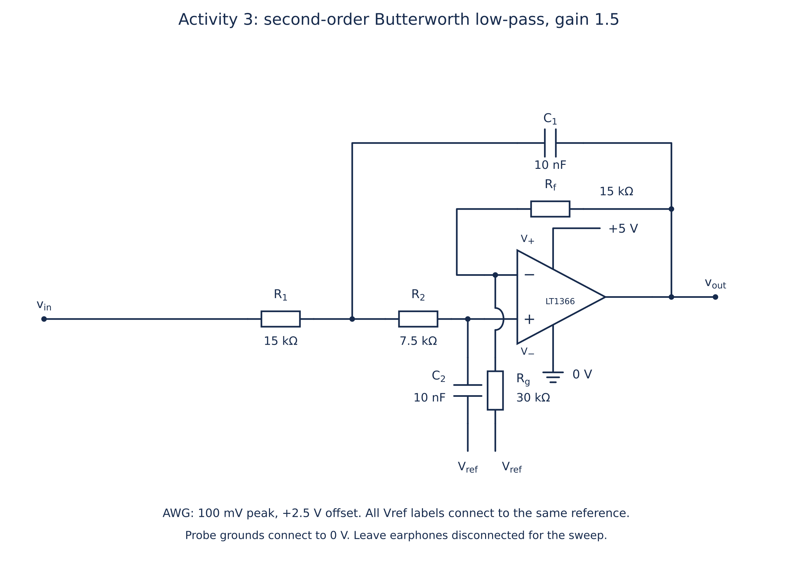
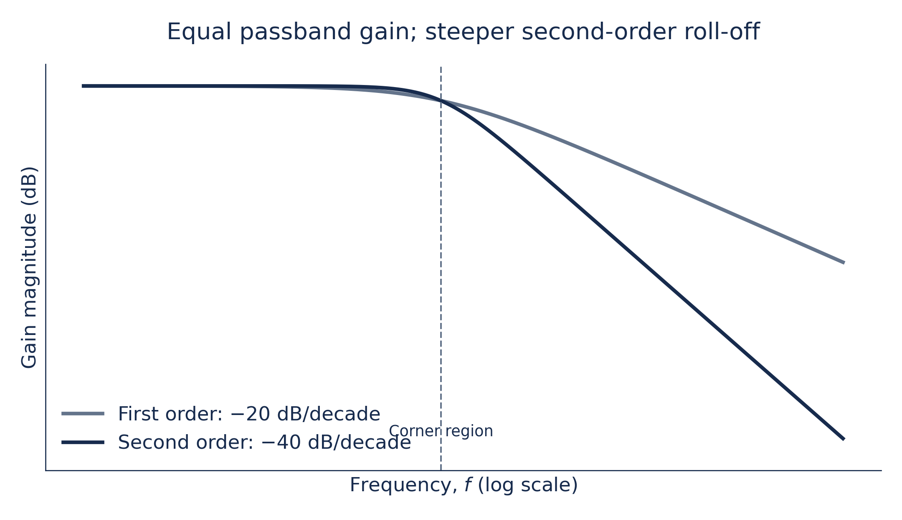
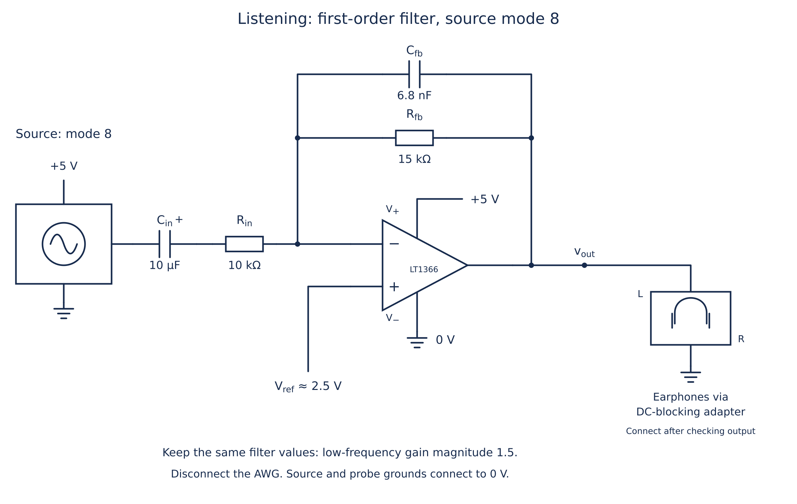
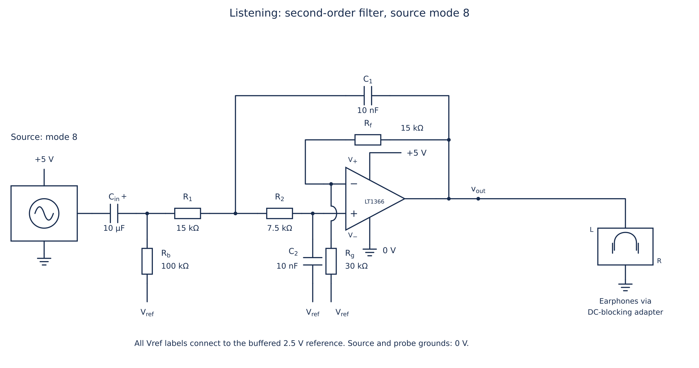

# Analysis and Design of Circuits Lab
# Part 2: Autumn Term weeks 8–10

## Section 2: Gain–Bandwidth Product and Active Filtering

In Section 1 you used negative feedback to set an amplifier's gain. That gain cannot remain constant at arbitrarily high frequencies: a real op-amp responds less strongly as frequency increases. First you will measure this bandwidth limitation. Then you will deliberately shape the frequency response by adding a capacitor to the feedback network, building **first- and second-order active low-pass filters**.

Activities 1–4 are **compulsory**: measure gain–bandwidth product, build and measure both active filters, compare their sound, and simulate the ideal second-order response in LTspice. Both filters have a low-frequency gain **magnitude of 1.5** and corners near 1.5 kHz. The final Filter Wizard task is a challenge conducted within the online tool only.

### Before the lab

1. Find the gain–bandwidth product (GBW, also called GBP), slew rate and open-loop gain-versus-frequency plot in the [LT1366 datasheet](https://www.analog.com/media/en/technical-documentation/data-sheets/1366fb.pdf).
2. Calculate the signal gain and noise gain for an inverting amplifier with 1.5 kΩ input resistance and 68 kΩ feedback resistance.
3. Calculate the passband gain and corner frequency of the first-order filter in Activity 2. Read the second-order circuit description and identify its two capacitors.
4. Prepare the measurement tables in your lab book. Predict the main features of each response before taking measurements.

### Supply, reference and measurement connections

Use the **same LT1366 module as Section 1**, powered from **+5 V and 0 V**. Connect V+ to +5 V and V− to 0 V. All oscilloscope and AWG ground connections go to **0 V**.

Make a 2.5 V reference with two 10 kΩ resistors between +5 V and ground. Use the module's second op-amp as a voltage follower to buffer this midpoint: connect the midpoint to its non-inverting input and connect its output directly to its inverting input. The buffer output is Vref. Both op-amps share the module's supply pins.

The buffer supplies a low-impedance reference without appreciably loading the divider. Check its output is approximately 2.5 V before connecting the experiment. **Vref is a bias node, not ground:** do not attach a probe ground clip to it. Keep this reference circuit while changing the experimental amplifier around the first op-amp.

Begin with earphones disconnected. Use DC coupling on both scope channels so that the bias and any clipping remain visible. Record DC levels separately from signal amplitudes.

## Activity 1: measure the gain–bandwidth product

### Why gain falls at high frequency

The **open-loop gain** is the op-amp gain without external negative feedback. Internal frequency compensation makes this gain decrease with frequency and helps the op-amp operate stably with feedback. The ideal infinite-gain model is therefore an approximation that becomes less accurate at high frequency.

For a predominantly single-pole op-amp, the open-loop gain falls approximately tenfold for a tenfold frequency increase over its dominant roll-off region. Its gain–bandwidth product is approximately constant there and is close to its unity-gain frequency. The LT1366 has a typical GBW of about **400 kHz**; this is a prediction for comparison, rather than an exact value for every device and operating condition.

Negative feedback sets the closed-loop gain below the available open-loop gain. A circuit requiring more gain generally has less bandwidth. For an inverting amplifier, the relevant quantity for estimating bandwidth is its **noise gain**:

$$
N=1+\frac{R_\mathrm{fb}}{R_\mathrm{in}},\qquad f_H\approx\frac{\mathrm{GBW}}{N}.
$$

The name “noise gain” describes how a small voltage disturbance at the non-inverting input is amplified; you do not need to measure noise in this experiment. It differs from the inverting signal-gain magnitude, $R_\mathrm{fb}/R_\mathrm{in}$.

Use **1.5 kΩ input resistance, 68 kΩ feedback resistance and a 1 µF input coupling capacitor**. Connect the non-inverting input to Vref. The predicted midband signal gain is approximately **−45.3**, the noise gain is **46.3**, and the upper bandwidth is approximately **8.6 kHz**.

The input coupling capacitor also causes a low-frequency high-pass transition near 106 Hz, ignoring AWG source resistance. This is separate from the op-amp's upper bandwidth limit. Use the approximately flat region between the two transitions to estimate midband gain.

### Build and measure

1. Build the circuit with the power off, using the reference above. Power on and verify that the output settles near 2.5 V.
2. Set the AWG to a **1 kHz sine wave, 10 mV peak (20 mV peak-to-peak), 0 V DC offset**. The input capacitor isolates the source's DC level from the internal bias.
3. Connect CH1 to the input before the coupling capacitor and CH2 to the output. Verify a clean, inverted sine wave. Reduce the input amplitude if necessary to avoid clipping or distortion.
4. Sweep the frequencies in the table. Measure the actual input amplitude at every frequency; do not rely solely on the AWG setting. Keep the input small enough for the amplifier to remain linear.
5. Calculate $|T|=V_\mathrm{out,pp}/V_\mathrm{in,pp}$ and $G_\mathrm{dB}=20\log_{10}|T|$. Plot gain and phase against logarithmic frequency.
6. Estimate the midband gain, then find the upper frequency where the gain magnitude falls to approximately **0.707 of that value**, or **3 dB below the midband level**. Add readings near this point.
7. Estimate $\mathrm{GBW}\approx46.3f_H$. Compare with the datasheet and explain differences, considering component tolerances, device variation and measurement uncertainty.

| Frequency (Hz) | Input p-p (V) | Output p-p (V) | Gain magnitude | Gain (dB) | Phase (°) |
| --- | --- | --- | --- | --- | --- |
| 100 | | | | | |
| 300 | | | | | |
| 1000 | | | | | |
| 3000 | | | | | |
| 6000 | | | | | |
| 8000 | | | | | |
| 10000 | | | | | |
| 20000 | | | | | |
| 40000 | | | | | |
| 100000 | | | | | |

**Measuring phase:** measure the horizontal separation $\Delta t$ between corresponding points on the two sine waves and divide by the period $T$. The phase magnitude is $360\Delta t/T$ degrees. You can count scope divisions for both quantities. Use crossings of each waveform's **own centre line**, rather than necessarily 0 V. Record a lag as negative and state your phase convention; inversion contributes 180°.

Above the upper corner, expect an approximately **−20 dB per decade** trend over the first-order region. Extrapolating this trend towards unity signal gain gives a useful approximate cross-check, but signal gain and noise gain differ. Use noise gain times measured bandwidth for your main estimate.

At very high frequencies the output may be small enough for noise and scope resolution to affect the ratio and phase. Mark unreliable readings. If the output becomes triangular or its shape depends strongly on amplitude, reduce the input and check again: slew-rate limitation is a large-signal effect, rather than the small-signal bandwidth being investigated.

- [ ] Plot the response, identify the upper −3 dB bandwidth and estimate GBW.
- [ ] Distinguish the input coupling transition from the op-amp bandwidth limit.

## Activity 2: build a first-order active low-pass filter

### From amplifier to filter

Putting a capacitor **in parallel with the feedback resistor** makes the feedback impedance frequency dependent. At low frequency the capacitor has high impedance and the feedback resistor sets the gain. At high frequency the capacitor provides a lower-impedance path, reducing the gain. This is the inverting low-pass topology investigated by Adam, with values chosen for modest gain and an audio-frequency corner.

Active filters can provide passband gain and avoid inductors, which can be bulky and have significant parasitic effects. A powered op-amp can also reduce output-loading effects within its bandwidth, current and voltage limits. Adding an op-amp alone does not make a first-order roll-off steeper.

| Component or property | Value |
| --- | --- |
| Input resistance, $R_\mathrm{in}$ | 10 kΩ |
| Feedback resistance, $R_\mathrm{fb}$ | 15 kΩ |
| Feedback capacitance, $C_\mathrm{fb}$ | 6.8 nF |
| Low-frequency signal gain | −1.5; magnitude 1.5, approximately 3.52 dB |
| Predicted corner frequency | Approximately 1.56 kHz |
| Non-inverting input reference | Approximately 2.5 V |

For the AC signal, assuming an approximately ideal op-amp:

$$
T_1(j\omega)=-\frac{R_\mathrm{fb}}{R_\mathrm{in}}\frac{1}{1+j\omega R_\mathrm{fb}C_\mathrm{fb}},\qquad
f_{c1}=\frac{1}{2\pi R_\mathrm{fb}C_\mathrm{fb}}.
$$

At the corner, the magnitude is 0.707 of the passband value: approximately **1.06**, or **0.51 dB**. A −3 dB corner means 3 dB **below the passband**, not necessarily an absolute gain of −3 dB.

### DC bias and input signal

There is no input coupling capacitor in the main measurement circuit. Set the AWG input to a **100 mV peak sine wave (200 mV peak-to-peak), with +2.5 V DC offset**, matching Vref. The output should also be centred near 2.5 V. At DC:

$$
V_\mathrm{out,DC}=V_\mathrm{ref}-\frac{R_\mathrm{fb}}{R_\mathrm{in}}(V_\mathrm{in,DC}-V_\mathrm{ref}).
$$

A zero-centred source connected directly would demand an output outside the supply range. A display offset on the scope does not fix the physical circuit. Check the actual input and output DC levels before measuring.

### Build and measure

1. Power off and build the filter, keeping the buffered reference and +5 V/0 V supplies. Leave earphones disconnected.
2. Apply the AWG signal specified above, initially at 100 Hz. Check the output DC level and an unclipped, inverted sine wave. Allow the voltages to settle after changes.
3. Connect CH1 to the input and CH2 to the output, with both probe ground clips at 0 V. Use DC coupling.
4. Measure the frequencies below. Calculate gain magnitude and gain in dB, and measure phase using crossings of each waveform's own centre line.
5. Plot gain and phase against logarithmic frequency. Identify the passband gain, −3 dB corner and approximate stopband slope. Add readings around the corner where needed.

Use this same frequency list for the second-order filter; add columns to one table or make a second copy. **Both filters must be measured.**

| Frequency (Hz) | Input p-p (V) | Output p-p (V) | Gain magnitude | Gain (dB) | Phase (°) |
| --- | --- | --- | --- | --- | --- |
| 100 | | | | | |
| 300 | | | | | |
| 600 | | | | | |
| 1000 | | | | | |
| 1500 | | | | | |
| 2000 | | | | | |
| 3000 | | | | | |
| 6000 | | | | | |
| 8000 | | | | | |
| 15000 | | | | | |

The ideal stopband slope is **−20 dB per decade**, the same as a first-order passive low-pass filter. The output is inverted: its phase may be plotted from +180° towards +90°, or continuously from −180° towards −270°. State your convention. The op-amp introduces further phase shift at sufficiently high frequency. The input resistance is approximately 10 kΩ in the intended operating region, so source loading is not eliminated.

- [ ] Build and characterise the first-order active low-pass filter.
- [ ] Distinguish its deliberate feedback-capacitor response from the op-amp bandwidth limitation measured in Activity 1.

## Activity 3: build a second-order active low-pass filter

A second-order filter has two energy-storage elements and can provide a steeper stopband roll-off. Simply adding another capacitor anywhere in the first circuit does not guarantee the required response: the arrangement and component ratios matter.

Build the **Sallen–Key low-pass filter** below. Its non-inverting amplifier has gain 1.5. One capacitor connects the junction of the two filter resistors to the output; the other connects the non-inverting input node to Vref. Check these connections carefully.

| Component or property | Value |
| --- | --- |
| First filter resistor, $R_1$, nearest the input | 15 kΩ |
| Second filter resistor, $R_2$, nearest the non-inverting input | 7.5 kΩ; two 15 kΩ resistors in parallel may be used |
| Feedback-path filter capacitor, $C_1$, from the R1/R2 junction to output | 10 nF |
| Shunt filter capacitor, $C_2$, from non-inverting input to Vref | 10 nF |
| Amplifier feedback resistor, $R_\mathrm{f}$ | 15 kΩ |
| Amplifier lower gain resistor, $R_\mathrm{g}$, returned to Vref | 30 kΩ; two 15 kΩ resistors in series may be used |
| Low-frequency gain, $K=1+R_\mathrm{f}/R_\mathrm{g}$ | +1.5 |
| Predicted −3 dB corner | Approximately 1.50 kHz |

For the equal capacitors $C_1=C_2=C$, the natural frequency and quality factor are:

$$
f_0=\frac{1}{2\pi C\sqrt{R_1R_2}},\qquad
Q=\frac{\sqrt{R_1R_2}}{R_2+(2-K)R_1}.
$$

These values give $Q=1/\sqrt{2}\approx0.707$: a **second-order Butterworth response**, with a flat passband and no ideal gain peak. For this response, $f_0$ equals the −3 dB corner. In general, a second-order natural frequency need not be its −3 dB frequency.

The small-signal transfer function is:

$$
T_2(s)=\frac{K}{1+s/(Q\omega_0)+(s/\omega_0)^2},\qquad \omega_0=2\pi f_0.
$$

Changing the amplifier gain changes the damping as well as the passband gain. Keep the stated resistor ratios rather than changing the gain resistors independently. See [TI's active low-pass filter design guide](https://www.ti.com/lit/an/sloa049d/sloa049d.pdf) for the Sallen–Key design equations.

### Build, measure and compare

1. Power off and replace the first-order experimental stage with the second-order circuit. Keep the same buffered Vref and +5 V/0 V supplies. Build the two filters **in turn**; they are not cascaded.
2. Keep the earphones disconnected. Apply the same **100 mV peak, +2.5 V offset AWG sine wave**, initially at 100 Hz. At DC, the filter capacitors are open; an input equal to Vref gives an output near Vref. Both signal inputs and the output should be close to 2.5 V.
3. Measure the second-order filter at the frequencies in Activity 2. Use CH1 at the input and CH2 at the output, both referenced to 0 V.
4. Plot both magnitude responses on the same axes. Identify the passband gains and corners. The nominal corners differ slightly (1.56 kHz and 1.50 kHz); allow for this when comparing them.
5. Compare gains at 8 kHz and slopes between 1.5 kHz and 15 kHz. The ultimate slopes are −20 and −40 dB per decade, but a measurement starting at the corner is still partly in the transition region.
6. Compare phase. The first-order circuit inverts; the second-order circuit does not invert at low frequency and its ideal phase moves from approximately 0° towards −180°. Account for that difference before comparing phase curves.

| Comparison | First order | Second order |
| --- | --- | --- |
| Measured passband gain magnitude | | |
| Measured −3 dB corner (Hz) | | |
| Attenuation at 8 kHz relative to passband (dB) | | |
| Observed stopband trend (dB/decade) | | |
| Low-frequency inversion? | | |

### Listen to both filters with source mode 8

Use the **signal-source module in mode 8: melody with an unwanted whine near 8 kHz**. This is the small source module used in Section 1, not a setting on the oscilloscope AWG. Power it from +5 V and 0 V.

1. Disconnect the AWG before connecting the source module. Keep the filter values unchanged: both circuits retain a nominal low-frequency gain magnitude of **1.5**.
2. For the **first-order filter**, connect source OUT through a **10 µF coupling capacitor**, then through its 10 kΩ input resistor. The capacitor blocks the source DC while the inverting node remains biased near 2.5 V.
3. For the **second-order filter**, connect source OUT through a **10 µF coupling capacitor** to a new input-bias node. Connect **100 kΩ from that node to buffered Vref**, then connect the node to $R_1$. This resistor establishes the DC input level when the capacitor blocks DC. Do not leave this input floating.
4. If the coupling capacitor is polarised, its positive terminal faces the biased filter and its negative terminal faces source OUT. Connect all source and scope grounds to 0 V. Allow the capacitor to charge, then verify an output near 2.5 V and no clipping before listening.
5. Listen first to the unfiltered mode-8 source, then to each filter output through the **DC-blocking earphone adapter**. Power off while moving connections. Begin at a low, comfortable listening level.
6. Compare the prominence of the whine and the clarity of the melody. An overall change in loudness alone is not evidence of selective noise removal: source loading and amplification also affect level.
7. Check the output waveform with and without the earphone load. If the load changes the response significantly or causes distortion, ask the demonstrator to help add a separate output buffer using an additional amplifier channel. Do not change the Sallen–Key gain resistors to control volume, because this also changes its damping.

The second-order filter should provide greater suppression of the 8 kHz tone. Both filters also attenuate wanted notes near 2 kHz; the second-order filter can make this upper part of the melody duller. Listen for this compromise rather than assuming a steeper filter always improves every aspect of the sound.

The source's output impedance and added coupling/bias network can alter the complete audio response, particularly the Sallen–Key component ratios seen by the signal. The AWG measurements are the main comparison with the calculated filter response. The coupling capacitor also introduces a low-frequency transition, so the listening circuits are approximately low-pass over the wanted audio band, rather than down to DC.

| Listening observation | Unfiltered source | First-order filter | Second-order filter |
| --- | --- | --- | --- |
| Prominence of the high-pitched whine | | | |
| Clarity/brightness of melody | | | |
| Overall listening level | | | |
| Clipping or distortion | | | |

- [ ] Build and characterise both filter orders and compare their sound using mode 8.

## Activity 4: obtain the ideal second-order response in LTspice

This simulation is **compulsory**. Use the same component values as the second-order hardware circuit so that the ideal prediction can be compared with measurements.

1. Draw the Sallen–Key circuit in LTspice, including its 2.5 V reference and input DC operating point. For the first run, use an **ideal op-amp** or an approximation with sufficiently large gain and bandwidth that its limitations do not affect this frequency range. Ask the demonstrator which ideal model is available. An ideal voltage-controlled voltage source with very large differential gain is another suitable small-signal model.
2. Set the input source to **DC 2.5 V and AC amplitude 1 V**. For this ideal baseline, use the main AWG measurement circuit without the audio coupling capacitor, source-module impedance or earphones.
3. Run an operating-point analysis first. Then run an AC sweep, for example **100 points per decade from 10 Hz to 1 MHz**.
4. Plot the magnitude in dB and phase of **$V(\mathrm{out})/V(\mathrm{in})$**. Locate the passband gain, −3 dB corner and approximately −40 dB/decade stopband trend.
5. Overlay or compare the measured second-order response with the ideal prediction. Compare attenuation at 8 kHz and explain differences, considering tolerances, source impedance and real op-amp behaviour.
6. Replace the ideal model with **LT1366**, including its +5 V/0 V supplies, and repeat the operating-point and AC analyses. Compare the ideal, realistic-model and measured results. High-frequency departures from the ideal filter can arise from finite op-amp gain and bandwidth.

A [companion ideal SPICE file](Part2_Section2_Ideal_Filters.cir) provides an ideal SPICE reference for both filter orders. Open it in LTspice, run it, and add traces `dB(V(out1)/V(in))` and `dB(V(out2)/V(in))` for the magnitude comparison. The ideal models deliberately omit supply clipping and output-current limits; they represent the ideal mathematical baseline, not a complete hardware model.

**AC analysis uses linearisation about the DC operating point.** Its 1 V AC setting is a normalisation, not a physical 1 V sine wave applied in a transient test. For transient analysis, use a small sine wave with the correct DC offset. Scope measurements use physical amplitudes and must remain unclipped.

- [ ] Present the ideal second-order curve, the LT1366-model curve and measured points, with an explanation of their differences.

## Challenge: explore sharper low-pass filters using Filter Wizard

Use the [Analog Devices Filter Wizard](https://tools.analog.com/en/filterwizard/) to investigate how sharper filtering changes the required filter order and number of op-amps. **Analyse these designs in Filter Wizard only: you do not need to build them on a breadboard or simulate them in LTspice.**

### Why does a sharper cut-off need more stages?

A real filter does not change abruptly from passing signals to blocking them. Its gain decreases through a **transition band**. Asking for little attenuation of wanted music but much greater rejection of a nearby unwanted tone generally requires a **higher-order filter**.

Higher-order active filters are commonly built by cascading second-order stages. Each second-order stage typically uses one op-amp, so a fourth-order filter normally uses two op-amp filter stages. Odd orders may include a first-order stage; inspect the tool's circuit to count the actual op-amps rather than assuming every design follows exactly the same arrangement.

For an all-pole low-pass response, the ultimate roll-off is approximately **−20 dB per decade per order**: first order gives −20 dB/decade, second order −40 dB/decade and fourth order −80 dB/decade. The slope close to the corner need not equal this ultimate slope. Response families also differ in passband flatness, ripple and transition shape.

### Compare designs in the tool

1. Choose a **low-pass** filter and keep the nominal passband gain the same for every comparison. Set the passband edge to **2 kHz** and the maximum passband loss to **1 dB**. The wanted music band is 200 Hz–2 kHz.
2. Use the **same response family** for all four designs below, preferably Butterworth, so that you can identify the effect of changing the requirements. Keep automatic order selection enabled where available, or increase the order until each specification is met.
3. First keep the stopband frequency at **8 kHz** and request progressively stronger rejection: **20 dB, 40 dB and 60 dB**, relative to the nominal passband gain.
4. Then keep the rejection at **40 dB** but move the stopband frequency closer to the wanted band, to **4 kHz**. This asks for the same rejection over a narrower transition band.
5. For each design, inspect the predicted response and generated circuit. Record the filter order, number of filter stages and actual number of op-amps. Do not count a separate bias or output buffer as a filter stage. There is no two-op-amp limit in this exploration: discovering when more stages are needed is part of the task.
6. Calculate the expected ultimate roll-off from the order. Inspect a sufficiently high-frequency part of the tool's response to see whether the slope is approaching that trend; do not estimate the ultimate slope only from the corner region. Keep the tool's assumed op-amp settings consistent across designs.

| Design | Passband edge / maximum loss | Stopband frequency | Required rejection | Filter order | Filter stages | Op-amps in tool circuit | Expected ultimate slope (dB/decade) |
| --- | --- | --- | --- | --- | --- | --- | --- |
| A | 2 kHz / 1 dB | 8 kHz | 20 dB | | | | |
| B | 2 kHz / 1 dB | 8 kHz | 40 dB | | | | |
| C | 2 kHz / 1 dB | 8 kHz | 60 dB | | | | |
| D | 2 kHz / 1 dB | 4 kHz | 40 dB | | | | |

### Explain what you find

- Compare A, B and C: how does demanding stronger rejection change the order, slope and op-amp count? Order changes in whole-number steps, so a small specification change does not always add another stage.
- Compare B and D: why does moving the stopband closer to the passband require a more selective filter?
- Which design would be appropriate for the mode-8 music and 8 kHz whine? Explain why the first- and second-order filters you built cannot match its combination of wanted-band preservation and unwanted-tone rejection.
- If time permits, compare one design with another response family. Does a sharper transition come with passband ripple or another change in the response?

Save the tool's response plots and complete the table in your lab book. The aim is to demonstrate that a tighter filtering specification generally needs a higher order and a more complex circuit with more op-amp stages.

- [ ] Compare the four tool designs and explain the relationship between specification, order, roll-off and circuit complexity.

[Return to Section 1: Amplification, Supply Rails and Biasing](Section1.md).
