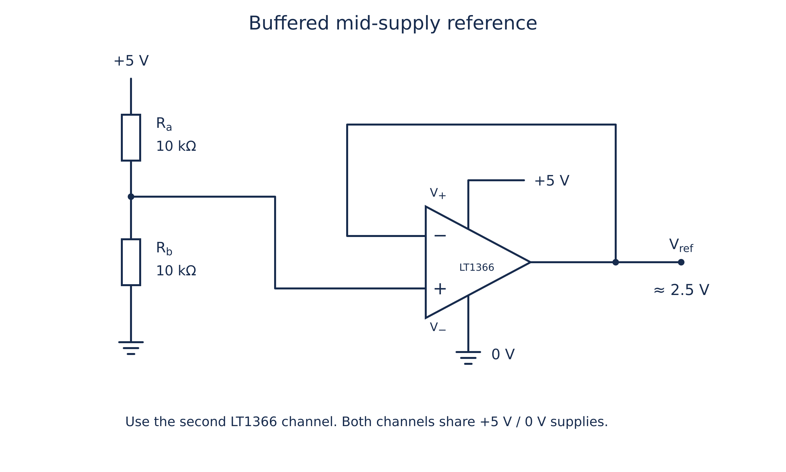
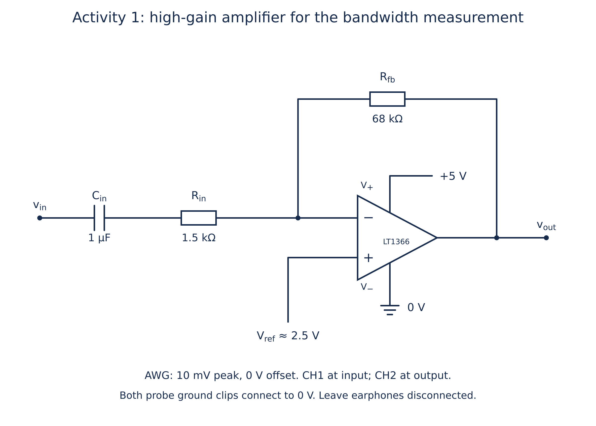
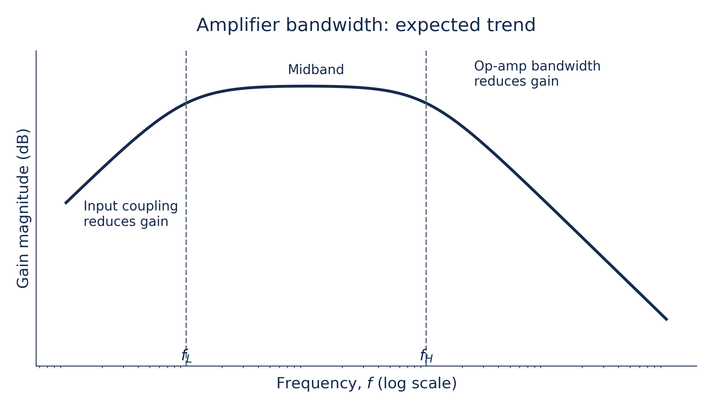
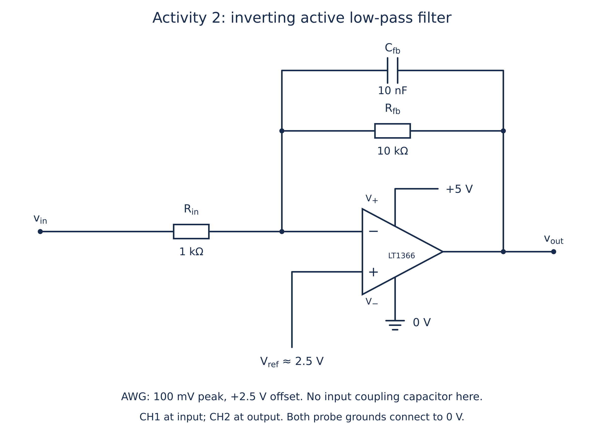
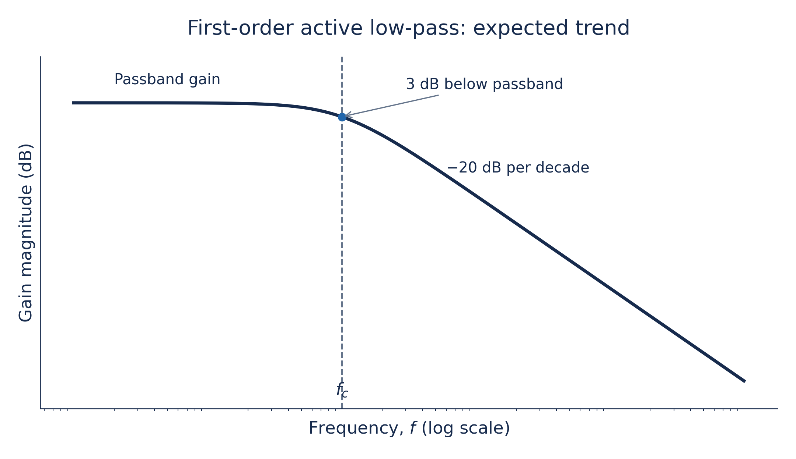
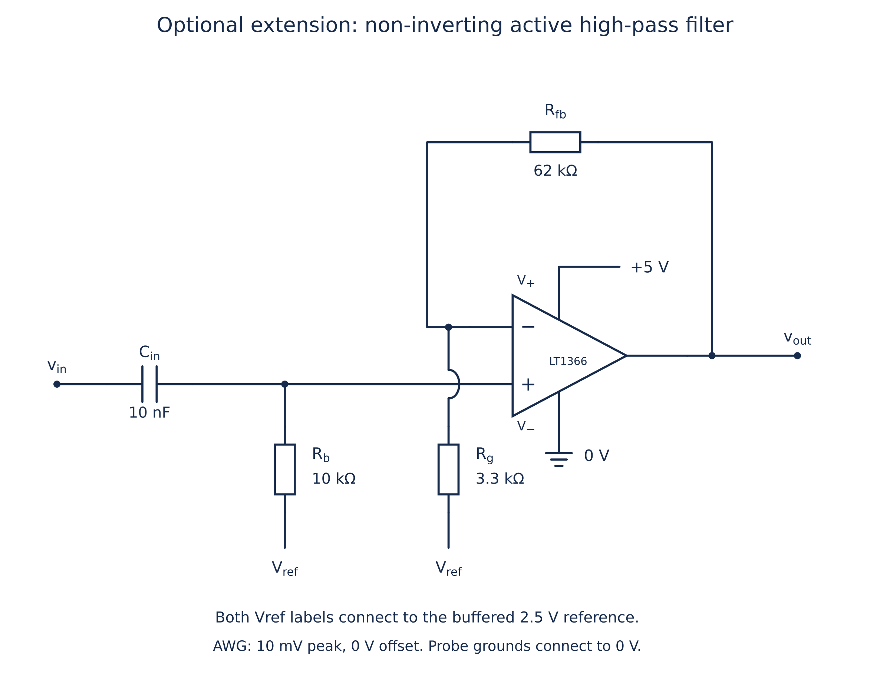
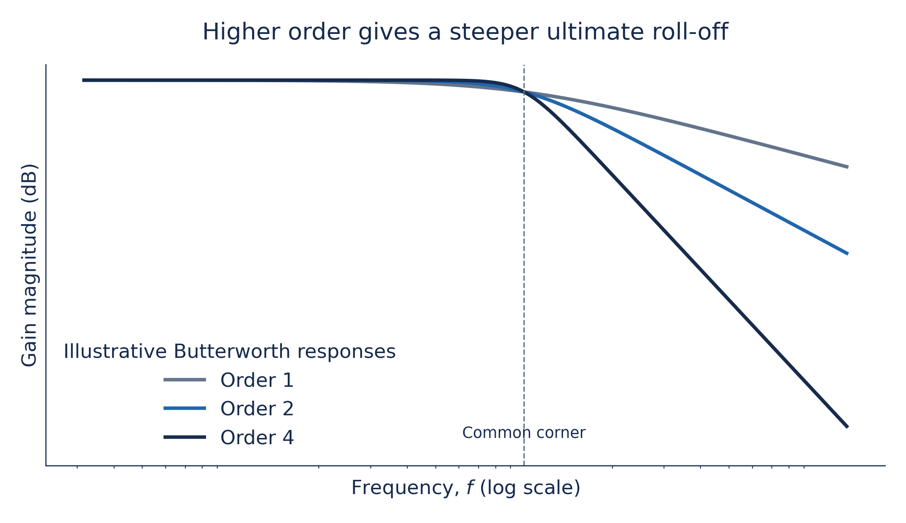

# Analysis and Design of Circuits Lab
# Part 2: Autumn Term weeks 8–10

## Section 2: Gain–Bandwidth Product and Active Filtering

In Section 1 you used negative feedback to set an amplifier's gain. That gain cannot remain constant at arbitrarily high frequencies: a real op-amp responds less strongly as frequency increases. First you will measure this bandwidth limitation. Then you will deliberately shape the frequency response by adding a capacitor to the feedback network, building an **active low-pass filter**.

Complete Activities 1 and 2 before attempting the extensions. The main filter is based on the inverting low-pass topology investigated by Adam. LTspice is an optional supporting activity for these experiments; the Filter Wizard challenge includes simulation before construction.

### Before the lab

1. Find the gain–bandwidth product (GBW, also called GBP), slew rate and open-loop gain-versus-frequency plot in the [LT1366 datasheet](https://www.analog.com/media/en/technical-documentation/data-sheets/1366fb.pdf).
2. Calculate the signal gain and noise gain for an inverting amplifier with 1.5 kΩ input resistance and 68 kΩ feedback resistance.
3. Calculate the passband gain and corner frequency of the low-pass filter in Activity 2.
4. Prepare the measurement tables in your lab book. Predict the main features of each response before taking measurements.

### Supply, reference and measurement connections

Use the **same LT1366 module as Section 1**, powered from **+5 V and 0 V**. Connect V+ to +5 V and V− to 0 V. All oscilloscope and AWG ground connections go to **0 V**.

Make a 2.5 V reference with two 10 kΩ resistors between +5 V and ground. Use the module's second op-amp as a voltage follower to buffer this midpoint, as shown. Both op-amps share the module's supply pins.

The buffer supplies a low-impedance reference without appreciably loading the divider. Check its output is approximately 2.5 V before connecting the experiment. **Vref is a bias node, not ground:** do not attach a probe ground clip to it. Keep this reference circuit while changing the experimental amplifier around the first op-amp.

Begin with earphones disconnected. Use DC coupling on both scope channels so that the bias and any clipping remain visible. Record DC levels separately from signal amplitudes.

## Activity 1: measure the gain–bandwidth product

### Why gain falls at high frequency

The **open-loop gain** is the op-amp gain without external negative feedback. Internal frequency compensation makes this gain decrease with frequency and helps the op-amp operate stably with feedback. The ideal infinite-gain model is therefore an approximation that becomes less accurate at high frequency.

For a predominantly single-pole op-amp, the open-loop gain falls approximately tenfold for a tenfold frequency increase over its dominant roll-off region. Its gain–bandwidth product is approximately constant there and is close to its unity-gain frequency. The LT1366 has a typical GBW of about **400 kHz**; this is a prediction for comparison, rather than an exact value for every device and operating condition.

Negative feedback sets the closed-loop gain below the available open-loop gain. A circuit requiring more gain generally has less bandwidth. For an inverting amplifier, the relevant quantity for estimating bandwidth is its **noise gain**:

$$
N=1+\frac{R_\mathrm{fb}}{R_\mathrm{in}},\qquad f_H\approx\frac{\mathrm{GBW}}{N}.
$$

The name “noise gain” describes how a small voltage disturbance at the non-inverting input is amplified; you do not need to measure noise in this experiment. It differs from the inverting signal-gain magnitude, $R_\mathrm{fb}/R_\mathrm{in}$.

Use **1.5 kΩ input resistance, 68 kΩ feedback resistance and a 1 µF input coupling capacitor**. Connect the non-inverting input to Vref. The predicted midband signal gain is approximately **−45.3**, the noise gain is **46.3**, and the upper bandwidth is approximately **8.6 kHz**.

The input coupling capacitor also causes a low-frequency high-pass transition near 106 Hz, ignoring AWG source resistance. This is separate from the op-amp's upper bandwidth limit. Use the approximately flat region between the two transitions to estimate midband gain.

### Build and measure

1. Build the circuit with the power off, using the reference above. Power on and verify that the output settles near 2.5 V.
2. Set the AWG to a **1 kHz sine wave, 10 mV peak (20 mV peak-to-peak), 0 V DC offset**. The input capacitor isolates the source's DC level from the internal bias.
3. Connect CH1 to the input before the coupling capacitor and CH2 to the output. Verify a clean, inverted sine wave. Reduce the input amplitude if necessary to avoid clipping or distortion.
4. Sweep the frequencies in the table. Measure the actual input amplitude at every frequency; do not rely solely on the AWG setting. Keep the input small enough for the amplifier to remain linear.
5. Calculate $|T|=V_\mathrm{out,pp}/V_\mathrm{in,pp}$ and $G_\mathrm{dB}=20\log_{10}|T|$. Plot gain and phase against logarithmic frequency.
6. Estimate the midband gain, then find the upper frequency where the gain magnitude falls to approximately **0.707 of that value**, or **3 dB below the midband level**. Add readings near this point.
7. Estimate $\mathrm{GBW}\approx46.3f_H$. Compare with the datasheet and explain differences, considering component tolerances, device variation and measurement uncertainty.

| Frequency (Hz) | Input p-p (V) | Output p-p (V) | Gain magnitude | Gain (dB) | Phase (°) |
| --- | --- | --- | --- | --- | --- |
| 100 | | | | | |
| 300 | | | | | |
| 1000 | | | | | |
| 3000 | | | | | |
| 6000 | | | | | |
| 8000 | | | | | |
| 10000 | | | | | |
| 20000 | | | | | |
| 40000 | | | | | |
| 100000 | | | | | |

**Measuring phase:** measure the horizontal separation $\Delta t$ between corresponding points on the two sine waves and divide by the period $T$. The phase magnitude is $360\Delta t/T$ degrees. You can count scope divisions for both quantities. Use crossings of each waveform's **own centre line**, rather than necessarily 0 V. Record a lag as negative and state your phase convention; inversion contributes 180°.

Above the upper corner, expect an approximately **−20 dB per decade** trend over the first-order region. Extrapolating this trend towards unity signal gain gives a useful approximate cross-check, but signal gain and noise gain differ. Use noise gain times measured bandwidth for your main estimate.

At very high frequencies the output may be small enough for noise and scope resolution to affect the ratio and phase. Mark unreliable readings. If the output becomes triangular or its shape depends strongly on amplitude, reduce the input and check again: slew-rate limitation is a large-signal effect, rather than the small-signal bandwidth being investigated.

- [ ] Plot the response, identify the upper −3 dB bandwidth and estimate GBW.
- [ ] Distinguish the input coupling transition from the op-amp bandwidth limit.

## Activity 2: build an active low-pass filter

### From amplifier to filter

A capacitor's impedance decreases as frequency increases. Putting a capacitor **in parallel with the feedback resistor** makes the feedback impedance frequency dependent, so the amplifier gain becomes frequency dependent too.

At low frequency, the capacitor has high impedance and the feedback resistor sets the gain. At high frequency, the capacitor provides a lower-impedance feedback path, reducing the gain. This is Adam's inverting active low-pass topology, adapted for a single supply and a suitable bias point.

Active filters use a powered amplifier with resistors and capacitors to shape the response. They can provide passband gain and avoid inductors, which can be bulky and have significant parasitic effects. More complex active-filter circuits can produce higher-order responses, but require additional components and careful design.

Use the following values. Adam's 100 nF feedback capacitor gave a corner near 159 Hz; here **10 nF** moves it to approximately **1.59 kHz**.

| Component or property | Value |
| --- | --- |
| Input resistance, $R_\mathrm{in}$ | 1 kΩ |
| Feedback resistance, $R_\mathrm{fb}$ | 10 kΩ |
| Feedback capacitance, $C_\mathrm{fb}$ | 10 nF |
| Passband signal gain | −10; magnitude 10 or 20 dB |
| Predicted corner frequency | Approximately 1.59 kHz |
| Non-inverting input reference | Approximately 2.5 V |

For the AC signal, assuming the op-amp behaves approximately ideally:

$$
T(j\omega)=-\frac{R_\mathrm{fb}}{R_\mathrm{in}}\frac{1}{1+j\omega R_\mathrm{fb}C_\mathrm{fb}},\qquad
f_c=\frac{1}{2\pi R_\mathrm{fb}C_\mathrm{fb}}.
$$

At the corner the magnitude is 0.707 of the passband value: approximately **7.07**, or **17 dB** for this circuit. A −3 dB corner means 3 dB below the passband level, not necessarily an absolute gain of −3 dB.

### DC bias matters

There is **no input coupling capacitor** in the main filter shown. Set the AWG's DC offset to **+2.5 V**, matching Vref, so that the input and output are both centred near mid-supply. At DC the feedback capacitor is open, and:

$$
V_\mathrm{out,DC}=V_\mathrm{ref}-\frac{R_\mathrm{fb}}{R_\mathrm{in}}(V_\mathrm{in,DC}-V_\mathrm{ref}).
$$

Connecting a zero-centred source directly would demand an output outside the supply range. An offset added only to the scope display cannot fix the physical circuit. Small differences between AWG offset and Vref are also amplified; check the measured DC output before sweeping.

### Build and measure

1. Power off and build the filter, keeping the buffered reference and +5 V/0 V supplies. Leave earphones disconnected.
2. Set the AWG to **100 mV peak (200 mV peak-to-peak), +2.5 V offset**, initially at 100 Hz. Check the actual input and output DC voltages. Adjust the source offset towards measured Vref if necessary.
3. Confirm an unclipped output. If necessary, reduce the input amplitude and record the value used.
4. Connect CH1 to the filter input and CH2 to the output, with both probe ground clips at 0 V. Use DC coupling.
5. Measure the frequencies below, calculate gain and phase, and plot the response. Add readings around the corner to locate it more accurately.
6. Identify the passband gain, −3 dB corner and approximate stopband slope. Compare with the predictions and with a passive low-pass filter from Part 1.

| Frequency (Hz) | Input p-p (V) | Output p-p (V) | Gain magnitude | Gain (dB) | Phase (°) |
| --- | --- | --- | --- | --- | --- |
| 100 | | | | | |
| 300 | | | | | |
| 600 | | | | | |
| 1000 | | | | | |
| 1600 | | | | | |
| 2000 | | | | | |
| 3000 | | | | | |
| 6000 | | | | | |
| 8000 | | | | | |
| 10000 | | | | | |
| 20000 | | | | | |

The ideal stopband slope is **−20 dB per decade**, the same as a first-order passive low-pass filter. The op-amp provides gain and can reduce output-loading effects; it does not make a first-order transition sharper. Those advantages remain limited by its bandwidth, output-current capability and output swing. The filter also loads its source through an input resistance of approximately 1 kΩ.

The low-frequency output is inverted. Its phase can be shown from +180° towards +90°, or continuously unwrapped from −180° towards −270°; either convention is acceptable if used consistently. The real op-amp adds further phase shift at sufficiently high frequency.

- [ ] Build and characterise the active low-pass filter.
- [ ] Explain how changing feedback impedance produces the response and why it differs from the bandwidth limitation in Activity 1.

### Optional LTspice comparison

Simulate the circuit you have built using the LT1366 model and the actual component values. Include the +5 V/0 V supplies and bias reference. Check the DC operating point first. For AC analysis, give the input source **DC 2.5 V and AC amplitude 1 V**; AC amplitude is a small-signal normalisation, not a physical 1 V transient applied to the circuit.

Plot the ratio $V(\mathrm{out})/V(\mathrm{in})$ and compare it with your measured response. Use a small sine wave with the correct DC offset for a separate transient check. Explain differences rather than expecting an ideal op-amp to reproduce every measured feature.

### Optional extension: active high-pass filter

If time permits, build Adam's non-inverting high-pass topology with the single-supply biasing shown below.

Use a **10 nF input capacitor**, **10 kΩ from the non-inverting input to Vref**, **62 kΩ feedback resistance** and **3.3 kΩ from the inverting input to Vref**. The ideal high-pass corner is approximately **1.59 kHz**, and the passband gain is approximately $1+62/3.3=19.8$.

Use a **10 mV peak AWG sine wave with 0 V offset**; the input capacitor blocks DC and the reference resistor establishes the internal bias. Check a 2.5 V output operating point. Take selected readings from the Activity 2 table. The op-amp bandwidth eventually causes the gain to fall at high frequency, so the ideal high-pass plateau does not extend indefinitely.

## Challenge: design and build a sharper audio low-pass filter

Source-module mode 8 produces music with an unwanted tone near **8 kHz**. The wanted notes extend from **200 Hz to 2 kHz**. The first-order filter demonstrates low-pass behaviour, but its gradual transition cannot preserve the whole wanted band while strongly rejecting the whine.

Use the [Analog Devices Filter Wizard](https://tools.analog.com/en/filterwizard/) to design a more selective filter, then **build and test it using LT1366 op-amps**.

### Why does a sharper cut-off need more stages?

A real filter does not change abruptly from passing signals to blocking them. Its gain decreases through a **transition band**. Asking for little attenuation of the wanted music but much greater rejection of a nearby unwanted tone generally requires a **higher-order filter**.

Higher-order active filters are commonly built by cascading second-order stages. Each second-order stage typically uses one op-amp, so a fourth-order filter normally uses **two op-amp filter stages**. A higher-order all-pole low-pass response also has a steeper ultimate roll-off: approximately −40 dB per decade for second order and −80 dB per decade for fourth order. The precise transition shape depends on the chosen response, including any passband ripple.

In Filter Wizard, tighten the passband and stopband requirements and observe how the required order and number of stages change. Explain the trade-off between selectivity, circuit complexity and component sensitivity.

### Design requirements

| Requirement | Target |
| --- | --- |
| Wanted music band | 200 Hz–2 kHz |
| Maximum passband loss/ripple relative to nominal passband gain | 1 dB throughout the wanted band |
| Attenuation at 8 kHz relative to nominal passband gain | At least 40 dB |
| Filter stages | No more than two op-amp filter stages, up to fourth order |
| Op-amp | LT1366 |
| Supply | +5 V and 0 V, with suitable biasing |
| Output | Unclipped at the chosen test amplitude |

A fourth-order response may meet these targets with a suitable response family; do not assume every fourth-order design does. Compare the tool's predicted curves with all the requirements.

### Design, simulate, build and listen

1. Select a low-pass response in Filter Wizard and explore its order and stage count. Choose a design meeting the table and save the predicted response and circuit in your lab book.
2. Inspect the component values. Use available capacitors where possible, then obtain suitable resistances using available values or series/parallel combinations. The tool's component-selection options can help trade resistance against capacitance. Check the updated response after substitutions: allowing ±10% component changes does not guarantee that the filter still meets its specification.
3. Draw your complete circuit, including every supply, reference and coupling connection. Use a suitable mid-supply bias, approximately 2.5 V. Do not assume an AWG offset alone correctly biases every internal node or that a different op-amp selected by the tool is interchangeable with the LT1366.
4. **Simulate this challenge before building.** Use the LT1366 model in LTspice, check the DC operating point, then inspect gain and phase with the actual chosen values. Check that the LT1366's finite bandwidth supports the proposed response, particularly stages with peaking. Revise the design if needed.
5. Build with the power off. Use the two op-amps in one module for the two filter stages. A separate reference buffer or output buffer requires another available amplifier channel; ask the demonstrator for an additional module if required. The two-stage limit applies to the signal-filter stages.
6. Test electrically with an AWG, starting with a small sine wave and the DC offset required by your design. Check all DC operating points before sweeping. Measure the wanted band and rejection at 8 kHz, adding points wherever the passband has peaks or dips.
7. Calculate attenuation relative to the nominal passband gain, rather than reading an absolute gain as attenuation. For example, a filter with a passband gain of 20 dB needs a gain at 8 kHz no higher than −20 dB to provide 40 dB rejection.
8. Replace the AWG with source-module mode 8 through a suitable **AC-coupling and bias network**. Check that this added network does not significantly attenuate 200 Hz and that the output remains unclipped. Keep scope grounds at 0 V.
9. Connect the earphones through the DC-blocking adapter, using a suitable output buffer if needed. A circuit measured into a high-impedance scope load may behave differently when driving approximately 64 Ω. Start at a low listening level. Compare the original and filtered signals: is the whine reduced, and does the melody remain clear?

| Frequency (Hz) | Input p-p (V) | Output p-p (V) | Gain (dB) | Attenuation relative to nominal passband gain (dB) |
| --- | --- | --- | --- | --- |
| 200 | | | | |
| 500 | | | | |
| 1000 | | | | |
| 2000 | | | | |
| 4000 | | | | |
| 8000 | | | | |

Add readings at predicted passband peaks and dips; the few points in this table alone cannot prove that the whole passband meets the specification.

- [ ] Present your chosen response, order, circuit and actual component values.
- [ ] Compare simulated and measured results with the specification.
- [ ] Explain why the sharper transition requires a more complex circuit than the first-order filter, and describe the listening result.

[Return to Section 1: Amplification, Supply Rails and Biasing](Section1.md).
